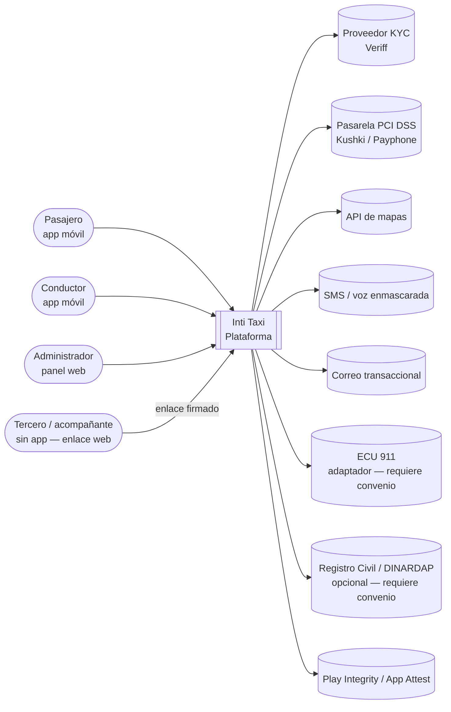
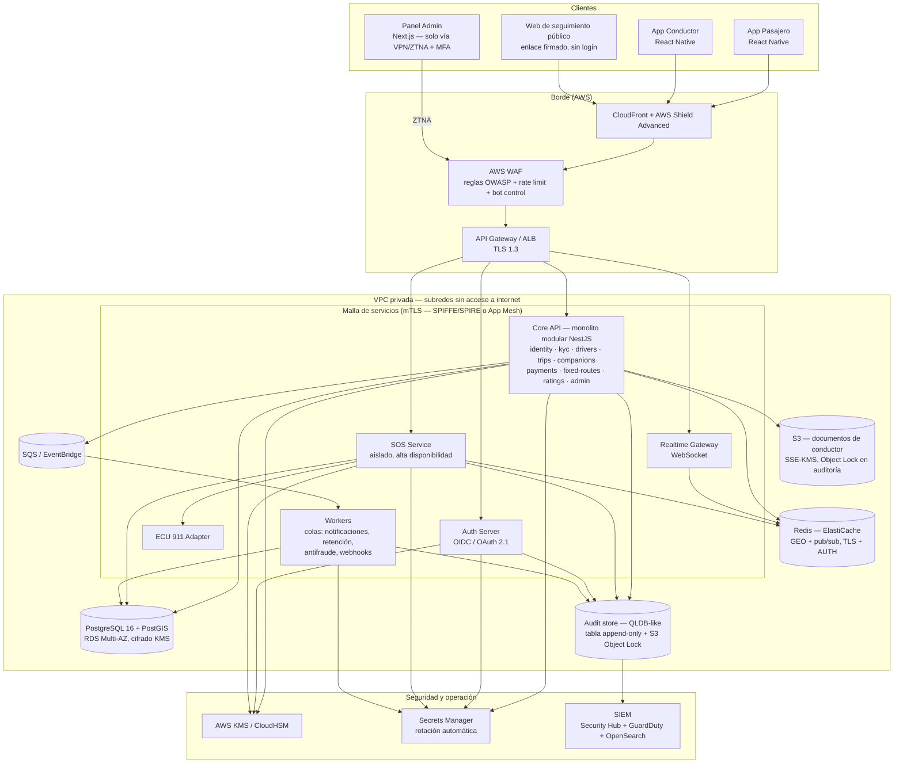
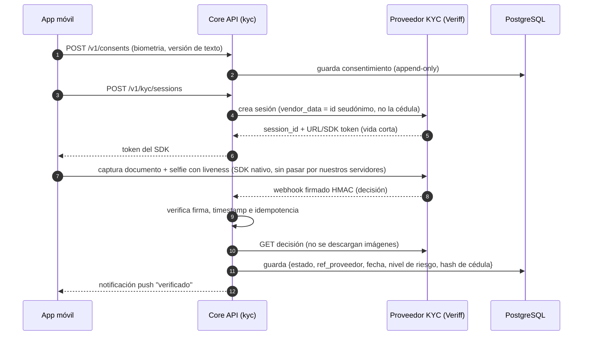
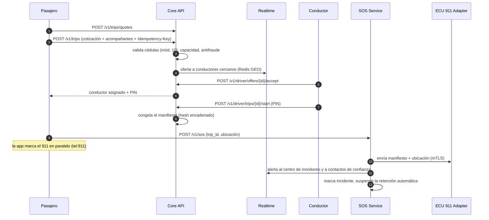

# 01 — Arquitectura

> Estado: **APROBADO (2026-10-19)**. Las decisiones marcadas con 🟡 tienen compromisos y están listadas en [`06-decisiones-pendientes.md`](06-decisiones-pendientes.md).

## 1. Principios

1. **Seguridad por diseño y por defecto**: denegar por defecto, mínimo privilegio, defensa en profundidad.
2. **Zero trust**: ninguna llamada se confía por venir "de dentro". Toda petición se autentica (usuario + dispositivo + servicio) y se autoriza a nivel de objeto.
3. **Minimización de datos (LOPDP art. 10)**: no guardamos lo que no necesitamos. La biometría queda en el proveedor KYC; las tarjetas, en la pasarela.
4. **Monolito modular primero, servicios después** 🟡: un backend con módulos de límites estrictos (sin acceso cruzado a tablas) y tres procesos desplegables aparte desde el día 1 por razones de seguridad/escala: `realtime-gateway`, `sos-service` y `workers`. Ver la justificación en el §5.
5. **Todo es configurable por datos**: rutas, paradas, tarifas y franjas horarias viven en base de datos y no en código.
6. **Inmutabilidad donde importa**: el manifiesto de viaje y el log de auditoría solo admiten inserciones (append-only) y se encadenan con hash.

## 2. Diagrama de contexto (C4 nivel 1)

## 3. Diagrama de contenedores (C4 nivel 2)

## 4. Flujos críticos

### 4.1 Verificación biométrica (KYC)

### 4.2 Solicitud de viaje con acompañantes y SOS

## 5. Stack recomendado y justificación

| Capa | Recomendación | Por qué | Alternativa |
|---|---|---|---|
| Móvil | **React Native (bare, TypeScript)**, 2 apps: pasajero y conductor 🟡 | Comparte tipos y validadores (cédula, tarifas) con backend y panel en un solo monorepo TS. Módulos nativos maduros para Keychain/Keystore, Play Integrity, App Attest y pinning. Separar apps reduce la superficie: el binario del pasajero no contiene código de conductor. | Flutter: mejor rendimiento de UI y ofuscación nativa de Dart, pero obliga a un segundo lenguaje y duplica validadores. |
| Protección MASVS-R | RASP comercial (p. ej. Guardsquare DexGuard/iXGuard o Talsec freeRASP) 🟡 | Ofuscación JS de Hermes + RASP nativo. La detección de Frida/root hecha en casa se evade fácilmente. | freeRASP (gratuito, menor cobertura). |
| Backend | **Node.js 22 + NestJS (TypeScript)** | Módulos, guards e interceptores encajan con RBAC y la autorización por objeto; ecosistema maduro (Prisma/Kysely, class-validator/Zod, Passport, `oidc-provider`). Mismo lenguaje que el resto. | Go: menor consumo y binarios mínimos, ideal si luego se extrae el `realtime-gateway`. |
| Servidor OIDC | **`node-oidc-provider`** (certificado por OpenID) embebido en el servicio `auth`, o Keycloak 🟡 | Certificado OIDC, soporta PKCE, DPoP, rotación de refresh tokens y PAR. Keycloak añade una JVM más que operar. | AWS Cognito: menos control sobre la rotación y los passkeys. |
| BD | **PostgreSQL 16 + PostGIS**, Row-Level Security como defensa adicional | Geometrías de rutas/paradas, `ST_DWithin` para emparejamiento, RLS como segunda barrera contra IDOR. | — |
| Tiempo real | **WebSocket** (`ws` + adaptador Redis) con autenticación por token y re-autenticación al expirar | Bidireccional y simple; MQTT solo aporta en redes muy inestables y requiere broker adicional. | MQTT (AWS IoT Core) para la app del conductor si se mide pérdida alta de conexión. |
| Ubicaciones en vivo | **Redis GEO** (TTL corto) + volcado por lotes a PostGIS para el manifiesto | Escrituras de alta frecuencia fuera de Postgres. | — |
| Mapas | **Google Maps Platform** 🟡 | Mejor cobertura de Guayaquil, Directions/Roads API (snap-to-road útil para detectar GPS falso), Places en español. | Mapbox: ~40-60 % más barato a volumen; geocodificación local más débil. |
| Nube | **AWS** 🟡 | KMS/CloudHSM, Shield Advanced, Nitro, Object Lock, QLDB/ledger tables, SOC 2 / ISO 27001 / PCI DSS. Región `us-east-1` (latencia ~60-80 ms a GYE) con DR en `us-west-2`; `sa-east-1` es opción. | GCP (Cloud HSM, Cloud Armor) — equivalente. |
| KYC | **Veriff** 🟡 | Ver §6. | Onfido (Entrust), Persona. |
| Pagos | **Kushki** 🟡 | Ver §7. | Payphone, Datafast. |
| IaC | Terraform + Checkov/tfsec + OPA (Conftest) | Políticas como código, revisión obligatoria. | AWS CDK. |
| CI/CD | GitHub Actions: Semgrep (SAST), OWASP ZAP (DAST), Trivy (contenedores/IaC), gitleaks (secretos), Dependabot + `pnpm audit`/OSV (SCA), MobSF (binarios móviles), SBOM con Syft, firma con Cosign | Cubre todo §4 Operación. | — |

### ¿Por qué monolito modular y no microservicios desde el día 1?
- **Seguridad:** menos saltos de red = menos superficie de mTLS, menos credenciales de servicio y menos configuraciones erróneas posibles. Los límites entre módulos se imponen por lint (`eslint-plugin-boundaries`) y por esquemas Postgres separados con roles de BD distintos.
- **Costo/UX:** un equipo pequeño entrega más rápido y con menos fallos operativos.
- **Excepciones:** `sos-service` se separa porque debe seguir funcionando aunque el core falle (aislamiento de fallos, escalado y credenciales propias); `realtime-gateway`, por el perfil de carga (conexiones largas); `ecu911-adapter`, porque tendrá credenciales y red propias del convenio.

## 6. Elección del proveedor KYC — Veriff (recomendado) 🟡

| Criterio | Veriff | Onfido | Jumio | Persona |
|---|---|---|---|---|
| Cédula ecuatoriana y pasaporte | Sí (catálogo de +12 000 documentos) | Sí | Sí | Sí |
| Liveness certificada (ISO/IEC 30107-3, iBeta) | Sí | Sí (Motion) | Sí | Vía socios |
| Detección de inyección / cámara virtual / deepfake | Sí, nativa en SDK | Sí | Sí | Parcial |
| SDK React Native | Oficial | Oficial | Oficial | Oficial |
| API de borrado de datos y retención configurable | Sí | Sí | Sí | Sí |
| ISO 27001 / SOC 2 | Sí / Sí | Sí / Sí | Sí / Sí | — / Sí |
| Presencia en LatAm | Fuerte | Media | Media | Media |

**Justificación:** buena relación entre detección de ataques de presentación e inyección (requisito §3), SDK que captura sin pasar las imágenes por nuestros servidores, re-verificación ligera para conductores ("selfie contra la verificación previa", ideal para la re-verificación aleatoria) y retención configurable con borrado por API. **Es preciso confirmar en la negociación comercial:** precio por verificación, residencia de datos (UE) y cláusulas de transferencia internacional conforme a la LOPDP.

**Qué guardamos:** `estado`, `referencia del proveedor`, `fecha`, `puntaje de riesgo`, `tipo de documento`, `hash HMAC de la cédula` (para detectar cuentas duplicadas sin guardar la cédula en claro en esta tabla). **No guardamos:** imágenes, vídeo ni plantillas faciales.

## 7. Pasarela de pagos — Kushki (recomendado) 🟡
- PCI DSS nivel 1, adquirencia local en Ecuador, tokenización con campos alojados (los datos de tarjeta nunca tocan nuestros servidores → alcance **SAQ A**), 3-D Secure 2, suscripciones y payouts.
- **Stripe** no ofrece cuentas a comercios constituidos en Ecuador (verificar en la fecha de contratación); solo sería viable con una entidad extranjera, lo que complica el aspecto fiscal.
- **Payphone** es una buena alternativa local, sobre todo para billetera/pagos desde el teléfono.
- **Billetera interna:** contabilidad de doble entrada en nuestra BD (libro mayor inmutable). ⚠️ Mantener saldos de usuarios puede considerarse actividad regulada (Junta de Política y Regulación Financiera); **requiere revisión legal** antes de habilitar recargas.

## 8. Seguridad transversal (dónde vive cada control)

| Control | Implementación |
|---|---|
| Tokens | Access token JWT de 5 min firmado con ES256 (clave en KMS), con *sender-constraint* DPoP ligado a la clave del dispositivo; refresh token opaco de 30 días, rotativo y con detección de reutilización (si se reutiliza → revocar toda la familia). |
| Atestación | Cada login y cada operación sensible exige un token de Play Integrity / App Attest verificado en el servidor (nonce emitido por nosotros). |
| Biometría del dispositivo | Par de claves generado en Secure Enclave/StrongBox con `userPresence`/`BIOMETRY_STRONG`; el servidor guarda solo la clave pública (igual que con passkeys). |
| Autorización | `PolicyGuard` (NestJS) + políticas por recurso (propietario, rol, relación con el viaje) + RLS en Postgres con `app.current_user_id`. Pruebas automáticas de IDOR por endpoint. |
| Cifrado de campo | Envelope encryption: DEK por tabla/tenant cifrada con CMK de KMS; AES-256-GCM; columnas `*_enc` + `*_hmac` (índice ciego para búsquedas exactas, p. ej. cédula). |
| Ubicaciones históricas | Tras el cierre del viaje y el período de disputas (30 días), los puntos GPS se generalizan (geohash de 7 caracteres) y se desvinculan del usuario, salvo incidente. |
| Auditoría | Tabla `audit_log` append-only (trigger que bloquea UPDATE/DELETE + hash encadenado) replicada a S3 con Object Lock (modo *compliance*) → SIEM. |
| Rate limiting | WAF (por IP/ASN) + Redis *sliding window* por usuario, dispositivo y teléfono; bloqueo progresivo exponencial en OTP/login. |
| SIM swap | Cambio de teléfono = MFA con passkey/correo + período de enfriamiento de 24-72 h para retiros; consulta de "SIM swap" al operador si se consigue convenio (Claro/Movistar/CNT); la huella de dispositivo cambia → step-up. |
| GPS falso | Señales del cliente (`isMock`, desarrollador, apps de mock) + servidor (velocidad imposible, saltos, discrepancia con IP/celda, snap-to-road). |

## 9. Entornos
- `local` (docker-compose, proveedores simulados), `dev`, `staging` (sandbox de Veriff/Kushki y **ECU 911 simulado**; el marcado al 911 queda deshabilitado por *feature flag* y se sustituye por un número de prueba), `prod`.
- Cuentas AWS separadas por entorno (AWS Organizations + SCPs). Los datos de producción nunca se copian a entornos inferiores.
