# 03 — Modelo de datos

> Estado: **APROBADO (2026-10-19)**.
> PostgreSQL 16 + PostGIS. Un esquema por módulo (`identity`, `kyc`, `drivers`, `trips`, `companions`, `manifest`, `payments`, `fixed_routes`, `audit`, `privacy`). Todos los IDs son `uuid` v7 (ordenables, no enumerables). Las marcas de tiempo son `timestamptz` en UTC; la conversión a `America/Guayaquil` ocurre solo en la lógica de negocio (tarifas) y en la presentación.

**Convenciones de datos personales**
- `*_enc bytea`: cifrado de campo AES-256-GCM con envelope encryption (DEK cifrada por CMK de KMS).
- `*_hmac bytea`: índice ciego HMAC-SHA256 (clave en KMS) para búsquedas por igualdad (p. ej. "¿esta cédula ya existe?").
- `*_last4` / `*_masked`: valor enmascarado precomputado para mostrar (`09******23`).
- 🔒 = dato personal; 🔒🔒 = dato sensible (LOPDP art. 26: biometría, salud, menores).

## 1. Diagrama entidad-relación

```mermaid
erDiagram
  USER ||--o| PASSENGER_PROFILE : tiene
  USER ||--o| DRIVER_PROFILE : tiene
  USER ||--o{ DEVICE : registra
  USER ||--o{ CREDENTIAL : "passkey / clave de dispositivo"
  USER ||--o{ CONSENT : otorga
  USER ||--o{ KYC_VERIFICATION : "se verifica"
  USER ||--o{ TRUSTED_CONTACT : define
  USER ||--o{ SAVED_COMPANION : guarda
  USER ||--o{ ADMIN_ROLE_ASSIGNMENT : "tiene (solo admins)"

  DRIVER_PROFILE ||--o{ DRIVER_DOCUMENT : sube
  DRIVER_PROFILE ||--o{ VEHICLE_ASSIGNMENT : conduce
  VEHICLE ||--o{ VEHICLE_ASSIGNMENT : ""
  VEHICLE ||--o{ DRIVER_DOCUMENT : "matrícula / SOAT"
  DRIVER_PROFILE ||--o{ DRIVER_ROUTE_ENABLEMENT : "habilitado en"
  DRIVER_PROFILE ||--o{ DRIVER_SESSION : "se conecta (con re-verificación)"

  TRIP ||--|{ TRIP_PARTY : "solicitante / pasajeros / acompañantes"
  PERSON ||--o{ TRIP_PARTY : participa
  PERSON |o--o| PERSON : "adulto responsable (menores)"
  TRIP }o--|| USER : "solicitado por"
  TRIP }o--o| DRIVER_PROFILE : "asignado a"
  TRIP }o--o| VEHICLE : "en"
  TRIP ||--o{ TRIP_LOCATION : "ruta GPS"
  TRIP ||--|| TRIP_MANIFEST : "congela"
  TRIP ||--o{ INCIDENT : "puede tener"
  TRIP ||--o{ PAYMENT : cobra
  TRIP }o--o| ROUTE_TRIP_INSTANCE : "si es Taxi Ruta"
  TRIP ||--o{ RATING : ""
  TRIP ||--o{ SHARE_LINK : "seguimiento"

  INCIDENT ||--o{ SOS_EVENT : ""
  INCIDENT ||--o{ AUTHORITY_DISCLOSURE : "entregas a autoridad"

  ROUTE ||--|{ ROUTE_DIRECTION : "ida / vuelta"
  ROUTE_DIRECTION ||--|{ ROUTE_STOP : "paradas ordenadas"
  STOP ||--o{ ROUTE_STOP : ""
  ROUTE ||--|{ FARE_RULE : "tarifa por franja"
  ROUTE ||--o{ ROUTE_SCHEDULE : horarios
  ROUTE ||--o{ DRIVER_ROUTE_ENABLEMENT : ""
  ROUTE_DIRECTION ||--o{ ROUTE_TRIP_INSTANCE : "salida de vehículo"
  ROUTE_TRIP_INSTANCE ||--o{ SEAT_BOOKING : ""
  SEAT_BOOKING }o--|| TRIP : "viaje del pasajero"

  WALLET ||--o{ LEDGER_ENTRY : ""
  USER ||--o| WALLET : ""
  PAYMENT ||--o{ LEDGER_ENTRY : ""
  USER ||--o{ PAYMENT_METHOD : "token de pasarela"
  DRIVER_PROFILE ||--o{ PAYOUT : retira

  USER ||--o{ AUDIT_LOG : "actor"
  PERSON ||--o{ DATA_SUBJECT_REQUEST : "ejerce derechos"
  PERSON ||--o{ THIRD_PARTY_NOTICE : "recibe aviso LOPDP"
```



> **`PERSON` vs `USER`:** `USER` es una cuenta con credenciales. `PERSON` es cualquier individuo que viaja o es registrado (titular de datos LOPDP), tenga o no cuenta. Un usuario tiene un `PERSON` asociado; un acompañante o tercero es solo `PERSON`. Esto permite gestionar el consentimiento y el borrado de terceros de manera uniforme.

## 2. Tablas principales

### 2.1 `identity`
| Tabla | Campos clave |
|---|---|
| `users` | `id`, `person_id` → persons, `phone_e164_enc` 🔒, `phone_hmac` (único), `email_enc` 🔒, `email_hmac` (único), `email_verified_at`, `phone_verified_at`, `status` (`active`/`locked`/`suspended`/`deleted`), `kyc_level` (0 = ninguno, 1 = documento + selfie), `created_at`, `deleted_at` |
| `persons` | `id`, `given_names_enc` 🔒, `family_names_enc` 🔒, `id_doc_type` (`cedula`/`passport`), `id_doc_number_enc` 🔒, `id_doc_hmac`, `id_doc_masked`, `id_doc_country`, `birth_date_enc` 🔒 (solo si es necesario para menores), `is_minor`, `guardian_person_id` → persons, `email_enc` 🔒, `phone_enc` 🔒, `registry_validated_at` (Registro Civil, si hay convenio), `created_by_user_id`, `retention_until` |
| `devices` | `id`, `user_id`, `platform`, `attestation_status`, `attested_at`, `fingerprint_hmac`, `push_token_enc`, `last_ip_hmac`, `risk_score`, `revoked_at` |
| `credentials` | `id`, `user_id`, `type` (`passkey`/`device_biometric_key`), `credential_id`, `public_key`, `sign_count`, `aaguid`, `device_id`, `created_at`, `revoked_at` — **solo claves públicas** |
| `refresh_token_families` | `id`, `user_id`, `device_id`, `current_token_hash`, `rotated_at`, `revoked_at`, `revoke_reason` |
| `otp_challenges` | `id`, `phone_hmac`, `code_mac` (HMAC-SHA256 con *pepper* en KMS: un código de 6 dígitos con hash lento seguiría siendo trivial de romper fuera de línea, así que la protección real la da la clave secreta), `attempts`, `expires_at` (5 min), `consumed_at` |
| `trusted_contacts` | `id`, `user_id`, `name_enc` 🔒, `phone_enc` 🔒, `consented_at` |
| `admin_role_assignments` | `user_id`, `role` (`super_admin`, `driver_reviewer`, `support`, `fraud_analyst`, `sos_operator`, `route_manager`, `auditor`, `dpo`), `granted_by`, `expires_at` (asignaciones temporales) |

### 2.2 `kyc` / `privacy`
| Tabla | Campos clave |
|---|---|
| `consents` | `id`, `person_id`, `purpose` (`biometric_kyc`, `audio_recording`, `trip_sharing`, `saved_companion`, `marketing`…), `text_version`, `text_hash`, `granted_at`, `revoked_at`, `channel`, `ip_hmac` — **append-only** |
| `kyc_verifications` | `id`, `user_id`, `kind` (`full`/`driver_reverify`), `provider`, `provider_session_ref`, `status` (`pending`/`approved`/`declined`/`resubmit`/`expired`), `risk_score`, `doc_type`, `doc_country`, `doc_number_hmac`, `name_match` (bool), `decided_at`, `expires_at` — **sin imágenes ni plantillas** |
| `data_subject_requests` | `id`, `person_id`, `type` (`access`/`rectify`/`delete`/`portability`/`object`), `status`, `verified_via`, `due_at` (plazo legal), `resolved_at` |
| `third_party_notices` | `id`, `person_id`, `trip_id`, `channel`, `sent_at`, `token_hash`, `confirmed_at`, `deletion_requested_at` |

### 2.3 `drivers`
| Tabla | Campos clave |
|---|---|
| `driver_profiles` | `user_id` (PK), `status` (`applicant`/`under_review`/`approved`/`suspended`/`rejected`), `license_number_enc` 🔒, `license_expires_on`, `approved_by`, `approved_at`, `last_reverified_at`, `online` |
| `driver_documents` | `id`, `driver_id`, `vehicle_id`, `type` (`license`/`registration`/`soat`/`insurance`/`background_check`), `s3_key` (SSE-KMS, nombre aleatorio), `sha256`, `mime`, `av_scan_status`, `expires_on`, `review_status`, `reviewed_by`, `reviewed_at`, `rejection_reason` |
| `vehicles` | `id`, `plate` (única), `make`, `model`, `year`, `color`, `seats_passenger` (capacidad), `status` |
| `vehicle_assignments` | `driver_id`, `vehicle_id`, `active_from`, `active_to` |
| `driver_sessions` | `id`, `driver_id`, `kyc_verification_id` (re-verificación usada), `started_at`, `ended_at`, `device_id` |
| `driver_route_enablements` | `driver_id`, `route_id`, `enabled_by`, `enabled_at`, `revoked_at` |

### 2.4 `trips` / `companions`
| Tabla | Campos clave |
|---|---|
| `trips` | `id`, `type` (`on_demand`/`fixed_route`), `requester_user_id`, `driver_id`, `vehicle_id`, `status` (máquina de estados: `requested → matching → accepted → arriving → in_progress → completed` / `cancelled` / `incident`), `origin geography(Point)`, `destination geography(Point)`, `quoted_fare_cents`, `final_fare_cents`, `currency` (`USD`), `fare_rule_id` (Taxi Ruta), `party_size`, `pin_hash`, `pin_attempts`, `requested_at`, `started_at`, `ended_at`, `is_for_third_party`, `incident_hold` (bool; suspende la retención), `retention_until` |
| `trip_parties` | `trip_id`, `person_id`, `role` (`requester`/`primary_passenger`/`companion`), `responsible_person_id` (menores), `boarding_stop_id`, `alighting_stop_id` (Taxi Ruta), `notified_at`, `tracking_link_id` |
| `saved_companions` | `id`, `owner_user_id`, `person_id`, `consent_id` (consentimiento **del acompañante**), `alias` |
| `trip_locations` | `trip_id`, `ts`, `point geography(Point)`, `speed`, `accuracy`, `source` (`driver`/`passenger`), `mock_flag` — particionada por mes; tras la retención → seudonimizada (geohash-7, sin `trip_id`) |
| `share_links` | `id`, `trip_id`, `audience` (`third_party`/`trusted_contact`/`authority`), `token_hash`, `scopes`, `expires_at`, `revoked_at`, `created_by` |
| `ratings` | `trip_id`, `rater_user_id`, `ratee_user_id`, `stars`, `comment_enc` |

**Restricciones clave**
- `CHECK (party_size BETWEEN 1 AND 8)`, más una validación transaccional: `party_size ≤ vehicles.seats_passenger` (on demand) o `≤ asientos libres` (Taxi Ruta, con `SELECT … FOR UPDATE`).
- Un menor (`is_minor = true`) debe tener un `responsible_person_id` presente en el mismo viaje o ser el solicitante (pendiente de confirmación legal: ¿pueden viajar menores sin adulto?).

### 2.5 `manifest` (inmutable)
| Tabla | Campos clave |
|---|---|
| `trip_manifests` | `id`, `trip_id` (único), `version` (1 al iniciar, nuevas versiones al cerrar o ante incidente — nunca se actualizan), `payload_enc` (JSON cifrado: solicitante, pasajeros, acompañantes, conductor + `kyc_verification_id` más reciente, vehículo/placa, horarios, referencia a la ruta GPS), `payload_sha256`, `prev_hash`, `chain_hash`, `signed_at`, `signature` (ECDSA con clave KMS) |
| `incidents` | `id`, `trip_id`, `type` (`sos`/`accident`/`other`), `opened_by`, `opened_at`, `status`, `severity`, `assigned_operator`, `legal_hold_until`, `closed_at` |
| `sos_events` | `id`, `incident_id`, `actor_person_id`, `actor_role`, `ts`, `point`, `ecu911_status` (`not_sent`/`sent`/`acked`/`failed`/`simulated`), `ecu911_ref`, `audio_recording_ref` |
| `authority_disclosures` | `id`, `incident_id` o `legal_request_ref`, `authority`, `legal_basis`, `share_link_id`, `disclosed_by`, `approved_by` (doble aprobación), `disclosed_at` |

Las tablas `trip_manifests`, `sos_events`, `consents` y `audit_log` tienen un trigger `BEFORE UPDATE OR DELETE → RAISE EXCEPTION`; su borrado por retención lo realiza **solo** un rol de BD dedicado (`retention_job`) mediante una función `SECURITY DEFINER` auditada.

### 2.6 `payments`
| Tabla | Campos clave |
|---|---|
| `payment_methods` | `id`, `user_id`, `gateway`, `gateway_token` (token de la pasarela; **nunca el PAN**), `brand`, `last4`, `exp_month`, `exp_year`, `fingerprint` |
| `payments` | `id`, `trip_id`, `payer_user_id`, `method` (`card`/`cash`/`wallet`), `amount_cents`, `currency`, `status`, `gateway_ref`, `three_ds_status`, `idempotency_key` (único), `risk_score` |
| `wallets` | `id`, `owner_user_id`, `currency` — **el saldo no se almacena**: se deriva del libro mayor (o de una vista materializada verificada) |
| `ledger_entries` | `id`, `tx_id`, `account` (`wallet:{id}`, `platform_revenue`, `driver_payable:{id}`, `gateway_clearing`…), `debit_cents`, `credit_cents`, `created_at` — append-only, `SUM(debit) = SUM(credit)` por `tx_id` |
| `payouts` | `id`, `driver_id`, `amount_cents`, `bank_account_ref` (tokenizado en la pasarela), `status`, `mfa_verified_at`, `requested_at`, `cooldown_until` |
| `fraud_signals` | `id`, `subject_type`, `subject_id`, `signal` (`velocity`, `device_reuse`, `ghost_trip`, `collusion`, `mock_gps`…), `score`, `created_at` |

### 2.7 `fixed_routes` (Taxi Ruta — 100 % configurable)
| Tabla | Campos clave |
|---|---|
| `routes` | `id`, `code` (`R1`), `name` ("Villa Bonita – Centro"), `city`, `status` (`draft`/`active`/`paused`), `vehicle_type`, `version` |
| `route_directions` | `id`, `route_id`, `direction` (`outbound`/`inbound`), `label` ("Villa Bonita → Centro"), `path geography(LineString)` (geometría validada con la API de mapas), `path_validated_at`, `validation_report jsonb` |
| `stops` | `id`, `name`, `location geography(Point)`, `reference`, `city` — reutilizables entre rutas |
| `route_stops` | `route_direction_id`, `stop_id`, `seq` (orden), `distance_from_start_m`, `UNIQUE(route_direction_id, seq)` |
| `fare_rules` | `id`, `route_id`, `name` ("Diurna"/"Nocturna"), `start_local time`, `end_local time` (puede cruzar la medianoche), `amount_cents`, `currency`, `per` (`person`), `valid_from date`, `valid_to date`, `priority` |
| `route_schedules` | `id`, `route_id`, `days_of_week int[]`, `service_start_local`, `service_end_local`, `headway_minutes` |
| `route_trip_instances` | `id`, `route_direction_id`, `driver_id`, `vehicle_id`, `status`, `departed_at`, `seats_total`, `seats_taken` (`CHECK seats_taken ≤ seats_total`) |
| `seat_bookings` | `id`, `instance_id`, `trip_id`, `boarding_stop_id`, `alighting_stop_id`, `seats`, `fare_rule_id`, `unit_fare_cents`, `status` — con `CHECK` de que la parada de subida esté antes que la de bajada en `seq` |

**Regla de tarifas (en `packages/domain`)**
```
hora_local = convertir(seat_booking.boarded_at, "America/Guayaquil")   -- momento en que el conductor confirma el abordaje (PIN)
regla = fare_rules activas de la ruta, vigentes en esa fecha,
        donde hora_local ∈ [start_local, end_local]  (con manejo de cruce de medianoche)
        ORDER BY priority DESC LIMIT 1
total = regla.amount_cents × número_de_personas
```
- Semilla de Ruta 1: Diurna `06:30:00–20:59:59` → 300; Nocturna `21:00:00–06:29:59` → 400.
- El panel validará que las franjas cubran las 24 h sin huecos ni solapamientos con la misma prioridad.
- ✅ **Hora de referencia (D14 aprobada)**: en Taxi Ruta, el momento en que se confirma el abordaje (`seat_bookings.boarded_at`); la cotización previa es solo estimada. `seat_bookings` guarda `boarded_at`, `fare_rule_id` y `unit_fare_cents` congelados en ese instante.

### 2.8 `audit`
| Tabla | Campos clave |
|---|---|
| `audit_log` | `id`, `ts`, `actor_user_id`, `actor_role`, `actor_device_id`, `action` (`read`/`create`/`update`/`delete`/`export`/`disclose`), `resource_type`, `resource_id`, `purpose` (obligatorio para lecturas de datos de terceros, p. ej. `sos_response`, `dispute`, `legal_request`), `justification` (texto libre para admins), `ip_hmac`, `request_id`, `prev_hash`, `hash` |

## 3. Retención (propuesta — **requiere revisión legal**)

| Dato | Plazo propuesto | Después |
|---|---|---|
| Manifiesto y datos de acompañantes/terceros | **180 días** desde el fin del viaje 🟡 ([X] de la especificación) | Borrado criptográfico (se destruye la DEK del lote) |
| Ruta GPS asociada al viaje | 30 días (período de disputas) | Seudonimización (geohash-7, sin IDs) para analítica |
| Viajes con incidente / requerimiento legal | Hasta el cierre del caso + plazo legal (`legal_hold_until`) | Revisión manual del DPO |
| Resultado KYC (sin biometría) | Mientras la cuenta esté activa + 1 año | Borrado |
| Imágenes biométricas en Veriff | Mínimo configurable en el proveedor (propuesta: 30 días para disputas de verificación) | Borrado por API del proveedor |
| Documentos de conductor | Mientras dure la relación + plazo legal laboral/tributario | Borrado |
| Registros contables / pagos | 7 años (normativa tributaria — **confirmar** con asesoría SRI) | Archivo cifrado |
| Grabaciones de audio SOS | 90 días si no hay incidente confirmado | Borrado |
| Log de auditoría | 5 años 🟡 | Archivo frío con Object Lock |
