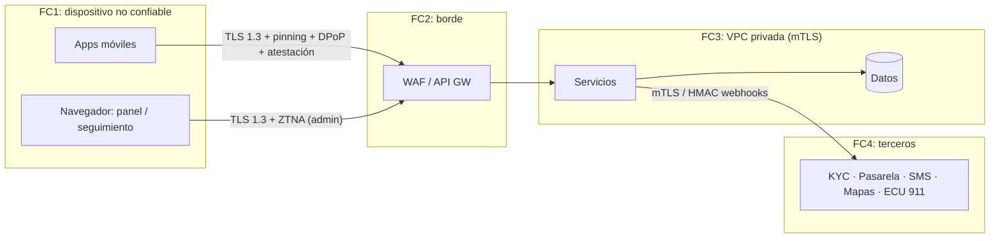

# 04 — Modelo de amenazas (STRIDE)

> Estado: **PROPUESTA — pendiente de aprobación.** Se revisará al cerrar cada módulo y antes del pentest externo.

## 1. Activos

| # | Activo | Clasificación |
|---|---|---|
| A1 | Identidad y credenciales de usuarios (tokens, passkeys, OTP) | Crítico |
| A2 | Resultado KYC y vínculo persona ↔ cuenta; imágenes biométricas (en el proveedor) | Crítico / sensible (LOPDP art. 26) |
| A3 | Datos de pasajeros, acompañantes, terceros y menores (cédula, nombres, correo) | Sensible |
| A4 | Ubicación en tiempo real e histórica | Sensible (permite rastrear a personas) |
| A5 | Manifiesto de viaje y log de auditoría | Crítico (evidencia legal) |
| A6 | Dinero: billetera, pagos, retiros de conductores | Crítico |
| A7 | Canal SOS / ECU 911 | Crítico para la vida — disponibilidad máxima |
| A8 | Configuración de rutas y tarifas | Alto (integridad) |
| A9 | Claves de KMS, secretos y credenciales de proveedores | Crítico |
| A10 | Panel de administración | Crítico (acceso masivo) |

## 2. Fronteras de confianza

## 3. Análisis STRIDE por componente

Leyenda de riesgo: **A** = alto, **M** = medio, **B** = bajo (después de la mitigación indicada → riesgo residual).

### 3.1 Autenticación (app ↔ auth)
| STRIDE | Amenaza | Mitigación | Residual |
|---|---|---|---|
| S | SIM swapping para tomar la cuenta por OTP | Passkey preferente; un cambio de dispositivo/SIM detectado → step-up (passkey o correo) y enfriamiento de 72 h para retiros y cambio de cuenta bancaria; aviso al correo; API de SIM swap del operador si hay convenio | M |
| S | Fuerza bruta / *credential stuffing* contra OTP | OTP de 6 dígitos, 5 min, máx. 5 intentos, bloqueo progresivo por teléfono+dispositivo+IP; captcha invisible tras fallos; WAF por ASN | B |
| S | Fraude de bombeo de SMS (*SMS pumping*) | Límite por prefijo/país, atestación obligatoria antes de enviar OTP, presupuesto diario y alertas | B |
| T | Robo y reutilización de refresh tokens | Rotación con detección de reutilización → revocación de la familia; DPoP ata el token a la clave del dispositivo | B |
| R | Usuario niega una operación sensible | Auditoría firmada con dispositivo, atestación y MFA usados | B |
| I | Tokens en logs o en almacenamiento inseguro | Solo Keychain/Keystore; los logs redactan `Authorization`, OTP y PII | B |
| D | Saturación del endpoint OTP | Rate limit en el WAF y en Redis; cola de SMS con *backpressure* | B |
| E | Cliente modificado o emulador que llama a la API | Play Integrity / App Attest con nonce del servidor en el login y en operaciones sensibles; RASP | M |

### 3.2 Verificación biométrica (KYC)
| STRIDE | Amenaza | Mitigación | Residual |
|---|---|---|---|
| S | Foto, máscara o deepfake frente a la cámara | Liveness certificada ISO 30107-3 del proveedor | M |
| S | Inyección de vídeo (cámara virtual, emulador, hooking) | Detección de inyección del SDK + nuestra atestación + RASP | M |
| S | Cuenta de conductor prestada o vendida | Re-verificación aleatoria antes de conectarse (selfie contra la verificación aprobada); probabilidad mayor ante señales de riesgo (nuevo dispositivo, otra ciudad, quejas) | M |
| T | Webhook del proveedor falsificado para "aprobarse" | Firma HMAC + ventana de tiempo + idempotencia; **se reconsulta la decisión por API** antes de aplicarla | B |
| R | Usuario niega haber consentido | Consentimiento append-only con versión y hash del texto | B |
| I | Filtración de imágenes biométricas | No se almacenan en nuestros sistemas; borrado configurado en el proveedor; DPA con el proveedor | B |
| I | Reutilización de una cédula en varias cuentas | `doc_number_hmac` único entre cuentas aprobadas | B |
| E | Usuario no verificado que accede a funciones de nivel KYC | Claim `kyc_level` en el token, verificado en el servidor contra la BD en operaciones críticas | B |

### 3.3 Onboarding de conductores y documentos
| STRIDE | Amenaza | Mitigación | Residual |
|---|---|---|---|
| T | Documentos adulterados | Revisión humana + KYC del conductor contra la licencia; verificación con ANT si hay convenio | M |
| I | Acceso público a los documentos en S3 | Bucket privado, Block Public Access, URLs prefirmadas de 60 s solo para revisores, auditoría de cada lectura | B |
| E | Carga de archivo malicioso (polyglot, macro) | Validación de magic bytes, solo JPEG/PNG/PDF, re-codificación de imágenes, antivirus, tamaño máximo, nunca se sirven desde nuestro dominio | B |
| E | Revisor que se auto-aprueba o aprueba a un conocido | Separación de funciones; un revisor no puede aprobar su propia cuenta; muestreo de segunda revisión | B |

### 3.4 Viajes, emparejamiento y acompañantes
| STRIDE | Amenaza | Mitigación | Residual |
|---|---|---|---|
| S | Persona que sube al vehículo equivocado / conductor impostor | PIN de 4 dígitos que el conductor introduce en su app; foto y placa visibles; re-verificación del conductor | B |
| T | Manipulación del precio cotizado | Cotización firmada en el servidor (ID + expiración + hash); el cliente nunca envía el precio | B |
| I | **BOLA/IDOR**: consultar viajes o acompañantes ajenos | Guard de políticas por objeto + RLS + IDs no enumerables + pruebas automáticas de IDOR por endpoint | B |
| I | Cédulas visibles en pantalla o capturas | Enmascarado `09******23`; `FLAG_SECURE` / ocultar la vista en el multitarea de iOS | B |
| I | Registro de datos de terceros sin su conocimiento | Aviso LOPDP a cada persona con enlace para consultar/eliminar; registro de la base legal | M (**revisión legal**) |
| R | Disputa sobre quién viajó | Manifiesto inmutable firmado | B |
| D | Solicitudes falsas masivas que bloquean conductores | Límites por usuario/dispositivo, antifraude, penalización por cancelaciones | M |
| E | Exceder la capacidad del vehículo | Validación transaccional en el servidor | B |

### 3.5 Tiempo real y ubicación
| STRIDE | Amenaza | Mitigación | Residual |
|---|---|---|---|
| S | GPS falso del conductor (inflar la tarifa) o del pasajero | Detección en el cliente + heurísticas en el servidor (velocidad, saltos, snap-to-road) + `fraud_signals` | M |
| I | Suscribirse al canal de ubicación de otro viaje | Autorización en cada suscripción a un canal (miembro del viaje o enlace firmado con alcance); re-verificación al expirar el token | B |
| I | Enlace de seguimiento reenviado a terceros no deseados | Enlace de un solo viaje, expira al finalizar + 15 min, revocable, sin datos de cédula, *rate limit* | M |
| I | Historial de ubicaciones que permite perfilar a usuarios | Seudonimización tras 30 días; acceso solo con propósito auditado | B |
| D | Avalancha de conexiones WebSocket | Autenticación antes del *upgrade*, límite de conexiones por usuario/IP, autoescalado | M |

### 3.6 Pagos
| STRIDE | Amenaza | Mitigación | Residual |
|---|---|---|---|
| I | Exposición de datos de tarjeta | Campos alojados por la pasarela (SAQ A); nunca recibimos el PAN | B |
| T | Doble cobro / repetición | `Idempotency-Key` obligatoria; webhooks firmados e idempotentes | B |
| T | Manipulación del saldo de la billetera | Libro mayor de doble entrada append-only; conciliación diaria con la pasarela; alertas de descuadre | B |
| S | Robo de cuenta → retiro a una cuenta bancaria del atacante | MFA (passkey) para cambiar la cuenta bancaria y para retirar; enfriamiento de 72 h tras un cambio; notificación | B |
| E | Colusión conductor-pasajero (viajes fantasma para cobrar incentivos) | Grafo de pares frecuentes, misma huella de dispositivo/red, rutas cortas repetitivas, revisión manual | M |

### 3.7 SOS, manifiesto y ECU 911
| STRIDE | Amenaza | Mitigación | Residual |
|---|---|---|---|
| D | SOS no disponible cuando el core falla | Servicio aislado multi-AZ con su propia ruta de red; la app **siempre** marca el 911 de forma nativa aunque falle la API; reintentos con cola persistente; SMS de respaldo | M |
| S | SOS falsos masivos (acoso, saturación del ECU 911) | El SOS está ligado a un viaje activo y a un usuario autenticado; triaje del centro de monitoreo antes de escalar si el convenio lo permite; límite y revisión de abusos (**nunca bloquear la llamada al 911**) | M |
| T | Alteración del manifiesto tras un incidente | Versiones append-only con hash encadenado y firma KMS; copia en S3 Object Lock | B |
| I | Fuga del manifiesto mediante el enlace firmado para autoridades | Enlace con expiración corta (p. ej. 24 h), un solo uso o con contador, ligado al `incident_id`, doble aprobación interna, marca de agua y auditoría de cada acceso | M |
| I | Compartir datos con autoridades sin base legal | Registro `authority_disclosures` con base legal obligatoria, aprobación del DPO o de su suplente | M (**revisión legal**) |
| R | Operador niega haber visto/actuado ante un SOS | Auditoría de cada acción del operador | B |
| E | Pruebas que llegan al 911 real | Feature flag por entorno; en no-producción el adaptador es `mock` y el marcado usa un número de prueba; test en CI que lo verifica | B |

### 3.8 Taxi Ruta
| STRIDE | Amenaza | Mitigación | Residual |
|---|---|---|---|
| T | Cambio malicioso o erróneo de tarifas o paradas | Rol `route_manager` + MFA + doble aprobación para publicar; versionado de rutas; auditoría | B |
| T | Cobro con tarifa equivocada por la zona horaria | Cálculo solo en el servidor con `America/Guayaquil` (tzdata); pruebas de frontera 06:29/06:30/20:59/21:00 | B |
| D | Reserva masiva de asientos (bloqueo de la ruta) | Límite de asientos por usuario, expiración de reservas no pagadas, antifraude | M |
| E | Conductor no habilitado que toma la ruta | Comprobación de `driver_route_enablements` al iniciar una instancia | B |

### 3.9 Panel de administración
| STRIDE | Amenaza | Mitigación | Residual |
|---|---|---|---|
| S | Phishing a administradores | Passkeys obligatorias (resistentes al phishing), ZTNA/VPN, sesiones de 8 h con reautenticación para acciones críticas | B |
| I | Exportación masiva de datos personales | Sin exportación masiva por defecto; búsquedas con propósito obligatorio; límites y alertas de lecturas anómalas en el SIEM | M |
| E | Escalada de privilegios entre roles | RBAC con roles mínimos, asignaciones con expiración, *break-glass* auditado, revisión trimestral de accesos | B |
| T | XSS/CSRF en el panel | CSP estricta con nonces, cookies `SameSite=Strict`, `HttpOnly`, `Secure`, plantillas con escape automático | B |

### 3.10 Infraestructura y cadena de suministro
| STRIDE | Amenaza | Mitigación | Residual |
|---|---|---|---|
| T | Dependencia npm comprometida | Versiones exactas, bloqueo de scripts de instalación, SCA, SBOM, *provenance*, Renovate con espera de 7 días | M |
| E | Credenciales de nube filtradas | OIDC de GitHub → AWS (sin claves largas), SCPs, GuardDuty, rotación | B |
| I | Backups expuestos | Cifrados con CMK distinta, cuenta AWS de backups separada, restauraciones de prueba trimestrales | B |

## 4. Riesgos residuales que requieren decisión humana
1. **Datos de terceros y menores** — base legal del tratamiento (¿interés legítimo/seguridad vital o consentimiento?) → revisión legal.
2. **Abuso del SOS** frente a la obligación de no obstaculizar emergencias → protocolo con ECU 911.
3. **Transferencia internacional** de biometría al proveedor KYC (UE) → evaluación de impacto (EIPD/DPIA) obligatoria.
4. **Grabación de audio** dentro del vehículo → consentimiento de todos los ocupantes; revisión legal.
