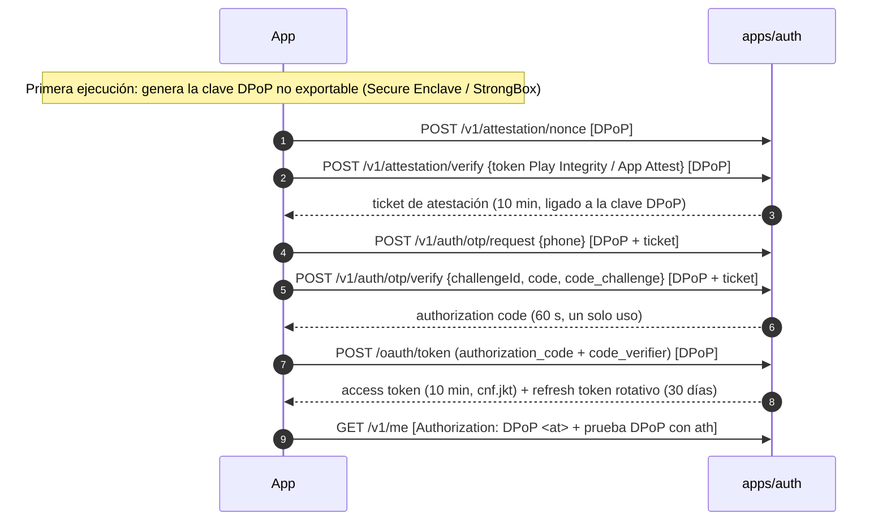

# Módulo 1 — Autenticación y sesiones

> Estado: **completado (backend + SDK cliente)** — 2026-10-19 · 118 pruebas automatizadas en verde.

## 1. Qué incluye

| Componente | Ubicación | Descripción |
|---|---|---|
| Servicio auth | `apps/auth` | NestJS. OTP SMS, emisión/rotación de tokens, passkeys, clave biométrica del dispositivo, step-up, sesiones, correo, cambio de número, atestación |
| Verificador de tokens | `packages/auth-verifier` | Verificación de tokens de acceso + DPoP (RFC 9449 / RFC 9068). Lo reutilizarán `api`, `realtime` y `sos` |
| SDK cliente | `packages/auth-client` | PKCE, pruebas DPoP y `TokenManager` (rotación con *single-flight*). Sin dependencias de Node: usable en React Native |
| Criptografía | `packages/crypto` | Envelope encryption AES-256-GCM (KMS/local), índices ciegos HMAC, enmascarado, tokens opacos |
| Dominio | `packages/domain` | Normalización de celular ecuatoriano (E.164) y correo |
| BD | `packages/db`, `db/migrations` | Migraciones inmutables (checksum), esquema `identity`, `audit.audit_log` con hash encadenado |
| Operación | `.github/workflows/ci.yml`, `infra/docker/auth.Dockerfile`, `.gitleaks.toml`, `.semgrep.yml` | CI con pruebas, gitleaks, Semgrep, `pnpm audit`, Trivy (IaC + imagen); imagen distroless *non-root* |

## 2. Flujo de autenticación

Es un flujo OAuth 2.1 para **apps nativas de primera parte**, alineado con el borrador IETF *OAuth 2.0 for First-Party Applications* (el *authorization challenge* ocurre en la app, sin navegador): PKCE S256 obligatorio, cliente público y tokens ligados a DPoP.



Métodos de inicio de sesión: **OTP SMS** (`amr=sms`, acr `basic`), **passkey** (`amr=hwk user`, acr `phr`) y **clave biométrica del dispositivo** (`amr=hwk`, acr `basic`).

Niveles de autenticación (`acr`):

| acr | Cómo se obtiene | Para qué sirve |
|---|---|---|
| `urn:intitaxi:acr:basic` | OTP SMS o clave del dispositivo | Uso normal de la app |
| `urn:intitaxi:acr:mfa` | Step-up con **código al correo verificado + firma de la clave del dispositivo** (usuarios sin passkey; no disponible durante el bloqueo anti SIM swap) | Operaciones sensibles de pasajeros (cambio de número, etc.) |
| `urn:intitaxi:acr:phr` | Passkey (MFA resistente al phishing) | Todo lo anterior + operaciones marcadas `@RequirePhishingResistant` (retiros y cuenta bancaria de conductores). Además levanta el bloqueo anti SIM swap |

El step-up dura 5 minutos. **El token de acceso dura 10 minutos** (decisión del 2026-10-19); la sesión se renueva sola con el refresh token rotativo durante 30 días.

## 3. Endpoints implementados

| Método | Ruta | Protección |
|---|---|---|
| POST | `/v1/attestation/nonce` · `/v1/attestation/verify` | DPoP |
| POST | `/v1/auth/otp/request` · `/v1/auth/otp/verify` | DPoP + atestación |
| POST | `/oauth/token` | DPoP (+ PKCE) |
| POST | `/oauth/revoke` | — (RFC 7009, siempre 200) |
| GET | `/jwks` · `/.well-known/oauth-authorization-server` | Público |
| GET | `/v1/me` | Token DPoP |
| POST | `/v1/me/email` · `/v1/auth/email/verify` | Token DPoP · token del enlace |
| POST | `/v1/auth/phone/change` | Token + atestación + **MFA reciente** |
| POST | `/v1/auth/phone/change/confirm` | Token + atestación |
| POST | `/v1/auth/passkeys/registration/options` · `/verify` | Token + atestación (+ MFA si ya existe una passkey) |
| POST | `/v1/auth/passkeys/authentication/options` · `/verify` | DPoP + atestación |
| POST | `/v1/auth/step-up/passkey/options` · `/verify` | Token |
| POST | `/v1/auth/device-keys` | Token + atestación |
| POST | `/v1/auth/device-keys/challenge` · `/assert` | DPoP + atestación |
| GET | `/v1/auth/sessions` | Token |
| DELETE | `/v1/auth/sessions/{id}` | Token (solo sesiones propias) |
| POST | `/v1/auth/logout` | Token |
| GET | `/healthz` · `/readyz` | Solo red interna |

## 4. Pruebas

```bash
# Requiere Postgres 16 y Redis 7 (docker compose up, o los servicios de la CI)
export DATABASE_URL=postgres://postgres:<pass>@127.0.0.1:5432/intitaxi_test
export REDIS_URL=redis://:<pass>@127.0.0.1:6379/1
pnpm install && pnpm build && pnpm test
```

| Suite | Pruebas | Qué cubre |
|---|---|---|
| `packages/crypto` | 17 | Cifrado/descifrado, AAD (anti copia entre filas), manipulación de bits, rotación de DEK, concurrencia, recuperación ante fallo de KMS, índices ciegos, enmascarado |
| `packages/domain` | 19 | Normalización de celulares y correos, entradas maliciosas |
| `packages/auth-verifier` | 19 | DPoP: htm/htu/typ/iat/jti, repetición, clave privada embebida, firma con otra clave; tokens: Bearer rechazado, token robado, `ath`, revocación, `alg:none`, emisor falso; MFA reciente |
| `packages/auth-client` | 7 | Vector de PKCE del RFC 7636, interoperabilidad de DPoP con el verificador, *single-flight* de la rotación, cierre de sesión ante `invalid_grant` |
| `apps/auth` (unitarias) | 17 | Veredictos de Play Integrity (app re-empaquetada, root, nonce, certificado…), bloqueo progresivo, salvaguardas de configuración de producción |
| `apps/auth` (integración, Postgres + Redis reales) | 39 | Ver la §5: cada mitigación tiene al menos una prueba |

## 5. Riesgos de seguridad y cómo se mitigan

| # | Riesgo | Mitigación implementada | Prueba |
|---|---|---|---|
| R1 | **Robo del token de acceso** (logs, proxy, malware) | Tokens ligados a DPoP (`cnf.jkt`): sin la clave privada del dispositivo, el token no sirve. Se rechaza el esquema `Bearer`. Vida de 10 min; el logout y la revocación lo cortan al instante | `rechaza el token… usado desde otra clave` |
| R2 | **Robo del refresh token** | Rotación en cada uso + detección de reutilización (revoca la familia y corta los tokens de acceso vigentes vía Redis) + ligado a la clave DPoP (presentarlo desde otra clave revoca la sesión) | `rota, y ante reutilización revoca…`, `…otra clave DPoP` |
| R3 | **Repetición de peticiones** | `jti` de DPoP de un solo uso (Redis), `iat` ≤ 60 s, `htm`/`htu`/`ath` verificados; `htu` se compara con la URL pública configurada, nunca con la cabecera Host | `rechaza la repetición…`, `…cabecera Host` |
| R4 | **Interceptación del código de autorización** | PKCE S256 + código de un solo uso de 60 s + ligado a la clave DPoP que hizo el login | `…otra clave DPoP (código interceptado)` |
| R5 | **Fuerza bruta del OTP** | 6 dígitos con `crypto.randomInt`; máx. 5 intentos por reto (luego se invalida); bloqueo progresivo por número (15 min → 1 h → 24 h); comparación en tiempo constante; MAC con *pepper* secreto (no basta un volcado de BD) | `invalida el reto tras 5 intentos…` |
| R6 | **Bombeo de SMS / abuso de OTP** | Atestación obligatoria antes de enviar; límites por número (3/15 min, 10/día), dispositivo (5/h) e IP (30/h) | `limita el envío de OTP…` |
| R7 | **Enumeración de cuentas** | Respuesta idéntica para números registrados y no registrados; el correo duplicado no se revela (se avisa al dueño); las sesiones ajenas responden 404 | `anti-enumeración`, `no revela si un correo…` |
| R8 | **SIM swapping** | Login solo con SMS en un dispositivo nuevo → bloqueo de operaciones sensibles durante 72 h + aviso por correo; la primera passkey no se puede registrar durante el bloqueo; añadir otra passkey exige MFA; el cambio de número exige passkey, avisa al número anterior y al correo, cierra las demás sesiones y vuelve a bloquear 72 h | `…dispositivo nuevo bloquea…`, `no permite registrar la primera passkey…`, `el cambio de número exige step-up…` |
| R9 | **App modificada, emulador o dispositivo rooteado** | Play Integrity verificado en el servidor (paquete, certificado de firma, `PLAY_RECOGNIZED`, `MEETS_DEVICE_INTEGRITY`, nonce de un solo uso ligado a la clave DPoP, frescura ≤ 2 min); ticket ligado a la clave; dispositivos revocados no pueden volver a atestarse | Unitarias de Play Integrity; `no acepta el ticket de otro dispositivo` |
| R10 | **BOLA/IDOR** sobre sesiones | Todas las consultas filtran por el `user_id` del token; los objetos ajenos dan 404 | `un usuario no puede cerrar la sesión de otro` |
| R11 | **Clonación de passkeys** / UV ausente | `userVerification: required`; contador de firmas monótono; solo claves públicas en la BD | `rechaza aserciones sin verificación de usuario o con contador que retrocede` |
| R12 | **Biometría expuesta** | La biometría nunca sale del teléfono: solo desbloquea una clave en Secure Enclave/StrongBox; el servidor guarda la clave pública y verifica firmas sobre retos de un solo uso, ligados al dispositivo | `la clave solo funciona en el dispositivo donde se registró` |
| R13 | **Fuga de datos personales en la BD** | Teléfono y correo cifrados a nivel de campo (AES-256-GCM, DEK envuelta por KMS, AAD por fila/columna); búsquedas por índice ciego; respuestas enmascaradas | `no guarda teléfonos en claro…`, unitarias de crypto |
| R14 | **Repudio / manipulación de evidencias** | `audit.audit_log` solo admite inserciones (UPDATE/DELETE/TRUNCATE bloqueados), cadena de hash verificable con `audit.verify_chain()`; sin PII en claro (IP como HMAC) | `registra eventos con la cadena de hash íntegra…` |
| R15 | **Configuración insegura en producción** | El servicio no arranca en producción con claves locales, atestación dev, sin TLS a Postgres/Redis, sin HTTPS o con proveedores de consola | Unitarias de `loadConfig` + prueba manual |
| R16 | **Fuga de información en errores** | RFC 9457 sin trazas ni mensajes internos; `Cache-Control: no-store`; los errores inesperados se registran con request id | `…no expone detalles internos`, `rechaza cuerpos demasiado grandes` |
| R17 | **Cabeceras / DoS por cuerpos grandes** | Helmet (HSTS con preload, CSP `default-src 'none'`, `nosniff`, `no-referrer`), sin `X-Powered-By`, límites de 32 KB (JSON) y 8 KB (form) | `aplica cabeceras de seguridad…` |
| R18 | **Cadena de suministro** | Versiones exactas, `pnpm` bloquea scripts de instalación salvo los permitidos, Dependabot, `pnpm audit`, Trivy, imagen distroless *non-root* | CI |

### Riesgos residuales y limitaciones conocidas (honestidad ante todo)

1. **App Attest (iOS) no está implementado.** `PendingAppAttestVerifier` falla cerrado: en modo `enforce` ningún iPhone puede iniciar sesión hasta implementarlo (verificación CBOR + cadena X.509 contra la *Apple App Attestation Root CA* y aserciones con contador). Lo propongo para el módulo 2, junto con el shell de la app iOS.
2. **Proveedores de SMS (Infobip) y correo (Amazon SES):** adaptadores implementados y probados con dobles; falta probarlos contra las cuentas reales (credenciales en Secrets Manager).
3. **La clave de firma de JWT está en memoria** (cargada desde Secrets Manager). Mejora prevista: firmar con una clave asimétrica de KMS para que la privada nunca salga del HSM.
4. **El login con clave del dispositivo da acr básico.** El servidor no puede comprobar que la clave exige biometría sin Key Attestation (Android) o App Attest (iOS). Por eso no sirve como MFA.
5. **El step-up por correo + dispositivo es más débil que la passkey** si roban el teléfono desbloqueado y el correo está abierto en él. Por eso no sirve para las operaciones marcadas como resistentes al phishing.
6. **DAST (OWASP ZAP)** se añadirá a la CI cuando exista un entorno de staging desplegado. Las *actions* de GitHub deben fijarse por SHA antes de activar la CI en el repositorio real.
7. Los **nonces DPoP del servidor** (`DPoP-Nonce`) no se usan; la ventana de `iat` es de 60 s más la detección de `jti` repetidos. Se pueden activar si el pentest lo recomienda.
8. La **app móvil** (módulos nativos de Keychain/Keystore, *certificate pinning*, RASP) aún no existe como proyecto: `auth-client` define las interfaces (`DpopSigner`, `SecureStore`) que implementarán los módulos nativos.

## 6. Revisión humana requerida
- **Pentest / revisión de código** de `apps/auth` y `packages/auth-verifier` antes del lanzamiento.
- **Legal (LOPDP):** textos de los avisos por SMS y correo, y la base legal del registro del dispositivo y de la IP como HMAC en la auditoría.

## 7. Decisiones aplicadas (2026-10-19)
1. SMS: **Infobip** (`SMS_PROVIDER=infobip`). Correo: **Amazon SES** (`EMAIL_PROVIDER=ses`).
2. Step-up: conductores → passkey obligatoria para retiros (`acr=phr`); pasajeros → passkey o correo + clave del dispositivo (`acr=mfa`).
3. Android rooteado/no certificado: **pasajeros permitidos** con la señal `device_integrity_basic_only` (sin tarjeta ni billetera, se aplica en el módulo de pagos); **conductores bloqueados**.
4. Token de acceso: **10 minutos**.
5. Para el simulador: `SMS_PROVIDER=devbox` / `EMAIL_PROVIDER=devbox` guardan los mensajes en Redis (prohibido en producción).
