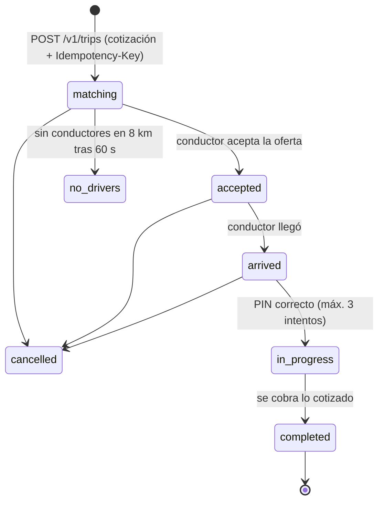

# Módulo 4 — Solicitud y emparejamiento de viajes

> Estado: **completado** — 2026-10-19. Pruebas: 10 unitarias de dominio (distancias, GPS imposible, tarifa, máquina de estados) y 12 de extremo a extremo.

## 1. Qué incluye

| Componente | Ubicación |
|---|---|
| Cotización con precio cerrado | `apps/api/src/modules/trips/trips.service.ts` |
| Emparejamiento secuencial (ofertas de 15 s, radio 5 → 8 km) | `matching.service.ts` |
| Presencia de conductores (Redis GEO) + detección de GPS falso | `presence.service.ts`, `packages/domain/src/geo.ts` |
| Máquina de estados del viaje | `packages/domain/src/trip-state.ts` |
| Tarifa bajo demanda (configurable) | `packages/domain/src/pricing.ts` |
| Mapas: Google Routes API / estimador local | `apps/api/src/infra/maps.ts` |
| Llamada enmascarada (auth custodia los teléfonos) | `apps/auth/src/modules/internal/contact.controller.ts` |
| Autenticación entre servicios (HMAC + nonce + marca de tiempo) | `packages/nest-common/src/internal-auth.ts` |
| Migración | `0007_trips.sql` |

## 2. Flujo

- **Conectarse** exige: app de conductor, perfil aprobado, documentos vigentes, consentimiento y re-verificación biométrica al día (módulo 2), y vehículo propio aprobado. Cada conexión queda en `drivers.online_sessions`.
- **Ofertas:** al conductor libre más cercano con asientos suficientes; si no responde en 15 s (o rechaza), pasa al siguiente. El barrido es seguro con varias instancias (`FOR UPDATE SKIP LOCKED`).
- **PIN:** 4 dígitos aleatorios, cifrado en la base de datos; solo lo ve quien pidió el viaje; el conductor lo introduce al subir el pasajero.

## 3. Endpoints

| Método | Ruta | Protección |
|---|---|---|
| POST | `/v1/trips/quotes` | Token |
| POST | `/v1/trips` | Token (app pasajero) + atestación + `Idempotency-Key` |
| GET | `/v1/trips` · `/v1/trips/{id}` | Token; solo participantes |
| GET | `/v1/trips/{id}/pin` | Token; solo quien pidió el viaje |
| POST | `/v1/trips/{id}/cancel` | Solicitante o conductor asignado (antes de iniciar) |
| POST | `/v1/trips/{id}/rating` | Participante; viaje completado ≤ 7 días; una vez |
| POST | `/v1/trips/{id}/contact-session` | Participante; viaje activo |
| POST | `/v1/driver/online` · `/offline` · `/location` | Token (app conductor) + atestación |
| GET | `/v1/driver/offers` · `/v1/driver/trips/current` | Token + atestación |
| POST | `/v1/driver/offers/{id}/accept` · `/reject` | Solo el conductor destinatario |
| POST | `/v1/driver/trips/{id}/arrived` · `/start` · `/complete` | Solo el conductor asignado |
| POST | `/internal/v1/contact-sessions` (auth) | Solo servicios internos firmados |

## 4. Decisión técnica: sin PostGIS por ahora
El emparejamiento por cercanía se hace en **Redis GEO** (alta frecuencia y baja latencia) y las coordenadas se guardan como `numeric(9,6)`. PostGIS no es necesario para este módulo. Se puede añadir más adelante para geocercas, mapas de calor y analítica sin cambiar la API. Esto evita una dependencia en todos los entornos; la CI ya usa una imagen con PostGIS.

## 5. Riesgos de seguridad y cómo se mitigan

| # | Riesgo | Mitigación | Prueba |
|---|---|---|---|
| R1 | **Manipulación del precio** | La cotización vive en el servidor (5 min), ligada al usuario y de un solo uso; el cliente nunca envía el precio | `el cliente no puede fijar el precio…` |
| R2 | **Subir al vehículo equivocado / conductor impostor** | PIN de 4 dígitos que solo ve el pasajero; 3 intentos y bloqueo; nombre verificado, placa y vehículo visibles; re-verificación biométrica antes de conectarse | `ciclo completo…`, `el PIN se bloquea tras 3 intentos` |
| R3 | **IDOR** (ver viajes, PIN u ofertas ajenas) | Cada consulta comprueba la relación del usuario con el viaje; 404 indistinguible; el conductor no ve el PIN | `nadie ajeno ve el viaje…` |
| R4 | **Peticiones duplicadas / dobles viajes** | `Idempotency-Key` obligatoria; índices únicos parciales (un viaje activo por pasajero y por conductor); bloqueos de fila al aceptar | `idempotencia…` |
| R5 | **GPS falso** (inflar distancias, aparecer cerca para robar viajes) | El cliente informa la ubicación simulada (`isFromMockProvider`); el servidor detecta saltos imposibles (> 180 km/h); las ubicaciones sospechosas no entran al emparejamiento y suman señales de fraude | `descarta ubicaciones con GPS falso…` |
| R6 | **Exposición de números de teléfono** | Llamada enmascarada: la API pide el número proxy al servicio auth mediante una llamada interna firmada; solo durante un viaje activo | `llamada enmascarada…` |
| R7 | **Abuso de solicitudes** (bloquear conductores) | Límites por usuario (cotizaciones y solicitudes), atestación obligatoria y un solo viaje activo | e2e |
| R8 | **Datos de ubicación personales** | Las direcciones de texto van cifradas; las coordenadas se seudonimizarán al vencer la retención (módulo 6) | `las direcciones se guardan cifradas` |
| R9 | **Dispositivo comprometido pagando con tarjeta** | Un pasajero con teléfono rooteado solo puede pagar en efectivo | `pasajero con teléfono rooteado: solo efectivo` |

### Riesgos residuales
- **Proveedor real de números enmascarados** (Infobip o Twilio con números ecuatorianos): pendiente. Producción no arranca con el simulado.
- **Tarifas:** son valores de ejemplo; hay que definirlas con el negocio y la ordenanza municipal.
- **Cancelaciones:** falta definir penalizaciones (regla de negocio).
- El bus de eventos es en proceso: con varias instancias de la API hay que llevarlo a Redis pub/sub o SQS (se hace en el módulo 6).
