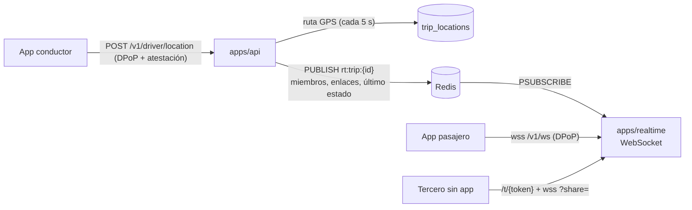

# Módulo 6 — Tiempo real (ubicación y seguimiento)

> Estado: **completado** — 2026-10-19. Pruebas: 3 unitarias (filtro de datos en el chat, tolerancia del GPS) y 7 de extremo a extremo con WebSocket real.

## 1. Arquitectura

- **Ingesta de ubicación** por REST en la API: autenticada, atestada y con detección de GPS falso. Se mantiene un solo punto de validación.
- **Difusión** por el gateway WebSocket (`apps/realtime`), que **no accede a la base de datos**: la API le deja en Redis quién puede suscribirse a cada viaje (`rt:trip:{id}:members`), qué enlaces son válidos (`rt:share:{hash}`) y el último estado (`rt:trip:{id}:last`).
- **MQTT** no se usa: WebSocket cubre el caso con menos infraestructura. Se puede añadir para la app del conductor si se miden conexiones inestables.

## 2. Qué incluye

| Componente | Ubicación |
|---|---|
| Gateway WebSocket (auth DPoP, canales, chat, límites) | `apps/realtime/src/gateway.ts`, `main.ts` |
| Página pública de seguimiento (mapa con Leaflet servido localmente) | `apps/realtime/public/track.*` |
| Puente API → tiempo real | `apps/api/src/modules/trips/realtime-bridge.service.ts` |
| Ruta GPS del viaje + seudonimización | `trip-tracking.service.ts`, migración `0009_trip_locations.sql` |
| Compartir con contactos de confianza | `POST/DELETE /v1/trips/{id}/share-links` |
| Portal del titular en HTML sin JavaScript | `GET /p/{token}` (API) |

## 3. Protocolo WebSocket (`/v1/ws`)

| Mensaje | Dirección | Notas |
|---|---|---|
| (cabeceras `Authorization: DPoP …` + `DPoP`) | upgrade | Apps nativas. La prueba DPoP se firma para `GET {PUBLIC_BASE_URL}/v1/ws` |
| `{type:"auth", authorization, dpop}` | → | Navegadores (no pueden fijar cabeceras); 5 s de plazo |
| `{type:"reauth", …}` | → | Antes de que venza el token (10 min) o se cierra con `4001 token_expired` |
| `{type:"subscribe", channel:"trip:{id}"}` | → | Solo miembros del viaje |
| `{type:"chat", tripId, text}` | → | ≤ 500 caracteres, 20/min, se ocultan teléfonos, correos y enlaces |
| `status` · `location` · `driver` · `chat` | ← | Los enlaces públicos solo reciben `status`, `location` y `driver` |
| `?share={token}` | upgrade | Enlace de seguimiento: solo lectura de UN viaje |

## 4. Riesgos de seguridad y cómo se mitigan

| # | Riesgo | Mitigación | Prueba |
|---|---|---|---|
| R1 | **Seguir un viaje ajeno** | Suscripción solo si el usuario está en la lista de miembros que mantiene la API | `un usuario ajeno no puede suscribirse` |
| R2 | **Token robado reutilizado en el WebSocket** | Misma verificación DPoP que la API (clave del dispositivo, `jti` único, revocación); cierre al vencer el token salvo `reauth` | `rechaza conexiones sin DPoP o con token robado…` |
| R3 | **Mensajes antes de autenticar** (carrera) | Los mensajes esperan a que termine la autenticación inicial (fallo detectado por las pruebas y corregido) | `chat…` |
| R4 | **Fuga por el enlace público** | Token de 256 bits; la página no expone datos personales del pasajero; `Referrer-Policy: no-referrer`, CSP estricta y sin scripts externos; solo recibe estado, ubicación y vehículo; caduca 15 min después del viaje | `el tercero sin app ve la página…` |
| R5 | **Salir de la plataforma por el chat / phishing** | Se ocultan teléfonos, correos y URLs; se guarda 7 días para reclamos | Unitarias + e2e |
| R6 | **DoS** | Límites de conexiones por IP y por usuario, de mensajes por IP y de chat por usuario; tamaño máximo de 8 KB; latido que cierra conexiones muertas | Código |
| R7 | **Perfilado por ubicaciones históricas** | Ruta precisa 30 días; luego se generaliza a ~110 m y al minuto; se borra con el manifiesto; los incidentes se conservan | `la ruta GPS se seudonimiza a los 30 días` |
| R8 | **GPS falso** | Detección de saltos imposibles con tolerancia de 100 m al ruido normal del GPS (falso positivo detectado por las pruebas y corregido) | Unitarias + e2e |
| R9 | **Compartir sin permiso** | Compartir con contactos requiere el consentimiento `trip_sharing`, máximo 5 enlaces y revocables | `compartir con contactos de confianza…` |

### Riesgos residuales
- **Teselas del mapa:** en desarrollo se usa OpenStreetMap; su política de uso no admite tráfico de producción, así que en producción hace falta un proveedor con contrato (Google o Mapbox).
- **Chat en Redis (7 días):** para usarlo como evidencia hay que persistirlo cifrado en la base de datos cuando el viaje pasa a incidente (módulo 8).
- **Multi-instancia:** el gateway es escalable horizontalmente (estado en Redis); los límites por usuario son por instancia.
