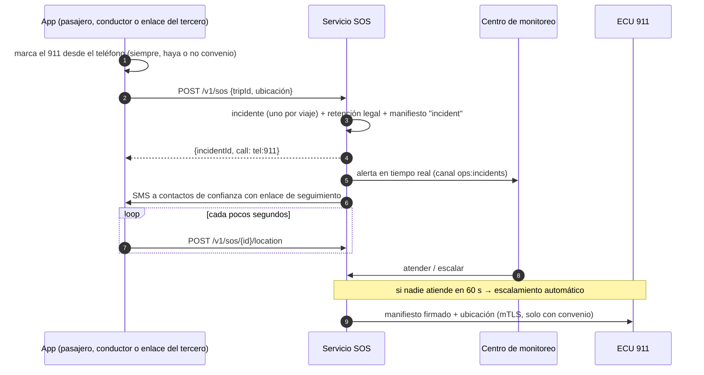

# Módulo 8 — Seguridad del viaje: PIN, SOS, manifiesto y ECU 911

> Estado: **completado** — 2026-10-19. Pruebas: 8 de extremo a extremo (auth + api + sos reales). Suite e2e total: 71 pruebas.

## 1. Qué incluye

| Componente | Ubicación |
|---|---|
| **Servicio SOS aislado** (mismo código, despliegue, red y credenciales propios) | `apps/api/src/main-sos.ts` + `modules/safety` |
| Manifiesto inmutable: versiones cifradas, encadenadas y firmadas (ES256) | `safety/manifest.service.ts` |
| SOS, accidentes, PIN de seguridad y de coacción, audio, centro de monitoreo | `safety/sos.service.ts` |
| Adaptador ECU 911 (`mock` · `signed_link` · `agreement` con mTLS) | `safety/ecu911.ts` |
| Entrega a autoridades con doble aprobación | `POST /v1/admin/authority-disclosures` |
| Contactos de confianza (los custodia auth) | `apps/auth/src/modules/trusted` |
| Migraciones | `0011_safety.sql`, `0012_trusted_contacts.sql` |

## 2. Manifiesto
- **Contenido:** el viaje, el solicitante, **todas las personas registradas** (con su documento completo, solo para emergencias y autoridades), el conductor (nombre, cédula y licencia verificados, y su **verificación biométrica más reciente**), el vehículo y la placa, las horas y la **ruta GPS completa**.
- **Versiones:** `start` (al iniciar), `end` (al terminar), `incident` (en cada SOS o escalamiento) y `authority_request`.
- **Integridad:** cada versión va cifrada (AAD por fila), `chain_hash = SHA-256(prev ‖ SHA-256(payload) ‖ viaje:versión)` y está firmada con ES256. La tabla solo admite inserciones (el borrado solo es posible dentro del job de retención). `latest()` verifica toda la cadena y devuelve `integrity: verified | TAMPERED`. La clave pública está en `GET /v1/manifest/public-key`.

## 3. Botón SOS

- **Quién puede activarlo:** el solicitante, los pasajeros con cuenta, el conductor (también como "accidente") y quien tenga el **enlace de seguimiento** de tercero o acompañante. El SOS **no exige atestación** (no puede fallar en una emergencia), pero sí ser participante del viaje.
- **Cancelar ("estoy bien")** exige el **PIN de seguridad**. Con el **PIN de coacción** la respuesta es idéntica a una cancelación normal, pero el incidente pasa a crítico y se escala de inmediato.
- **Audio:** solo del teléfono de quien activa la alerta, con consentimiento previo (`audio_recording`). Va cifrado por la aplicación y por el almacenamiento; se borra a los 90 días si no hay retención legal.
- **ECU 911 (decisión aprobada):** solo se envían datos ante una emergencia real (SOS o accidente).
  - `mock`: desarrollo; registra lo que "recibiría" el ECU 911. **Prohibido en producción.**
  - `signed_link`: sin convenio; el centro de monitoreo entrega un enlace firmado a las autoridades.
  - `agreement`: con convenio; TLS 1.3 con certificado de cliente (mTLS). El formato del mensaje se acordará con el ECU 911.

## 4. Entrega a autoridades
Un operador o el DPO la solicita con la autoridad y la **base legal**. **Otra persona** (DPO) la aprueba. Se genera un enlace (que se muestra una sola vez) válido 24 h y para 5 accesos, con marca de agua (destinatario, base legal, número de acceso) y la firma del manifiesto verificable. Cada acceso queda auditado.

## 5. Endpoints

| Servicio | Método | Ruta | Protección |
|---|---|---|---|
| sos | POST | `/v1/sos` · `/v1/sos/{id}/location` · `/v1/sos/{id}/cancel` | Token (participante); cancelar exige PIN |
| sos | POST | `/v1/sos/{id}/audio?seq=` | Token + consentimiento de audio |
| sos | PUT | `/v1/me/safety-pins` | Token + atestación (cambiar exige el PIN actual) |
| sos | POST | `/v1/track/{token}/sos` | Enlace de tercero/acompañante + límite por IP |
| sos | POST | `/v1/driver/trips/{id}/accident` | Conductor asignado |
| sos | GET/POST | `/v1/admin/incidents…` (lista, detalle, atender, escalar, cerrar) | `sos_operator` (cerrar: passkey ≤ 15 min) |
| sos | GET | `/v1/admin/trips/{id}/manifest?reason=` | `support`/`auditor`/`sos_operator` + motivo auditado |
| sos | POST | `/v1/admin/authority-disclosures` · `/{id}/approve` | Solicita `sos_operator`/`dpo`; aprueba **otro** `dpo` |
| sos | POST | `/v1/admin/trips/{id}/release-hold` | `dpo` |
| sos | GET | `/v1/authority/manifest/{token}` · `/v1/manifest/public-key` | Enlace firmado / público |
| auth | GET/POST/DELETE | `/v1/me/trusted-contacts` | Token |

## 6. Riesgos de seguridad y cómo se mitigan

| # | Riesgo | Mitigación | Prueba |
|---|---|---|---|
| R1 | **SOS caído cuando más se necesita** | Servicio aislado; no exige atestación; la app marca el 911 de forma nativa siempre; escalamiento automático si nadie atiende | `pasajero: incidente…` |
| R2 | **Coacción para cancelar la alerta** | PIN de coacción con respuesta idéntica, agravamiento y escalamiento silencioso | `cancelar con PIN; con el PIN de coacción…` |
| R3 | **Alteración de evidencias** | Manifiesto solo de inserción, cifrado, encadenado y firmado; se detecta una versión falsificada | `detecta un manifiesto adulterado` |
| R4 | **Datos a autoridades sin base legal** | Doble aprobación por personas distintas, base legal obligatoria, enlace temporal con accesos limitados y marca de agua, auditoría | `doble aprobación…` |
| R5 | **SOS falsos / abuso** | Solo participantes del viaje; un incidente por viaje; triaje del operador antes de escalar (máx. 60 s) | `solo los participantes…` |
| R6 | **Pérdida de datos por retención** | `incident_hold` suspende el borrado; el DPO lo libera solo sin incidentes abiertos ni retención legal vigente | e2e |
| R7 | **Grabaciones indebidas** | Solo con consentimiento previo, solo del dispositivo del activador, cifradas y con retención de 90 días | `audio: solo con consentimiento…` |
| R8 | **Pruebas que llegan al 911 real** | Adaptador `mock` que nunca hace llamadas; producción lo prohíbe | Configuración |
| R9 | **Acceso indebido del personal** | RBAC; cada vista de incidente o manifiesto se audita con su finalidad | `…sos_response` |

### Riesgos residuales
- **Convenio con el ECU 911:** sin él solo funcionan la llamada al 911 y el enlace firmado. El formato del mensaje del adaptador `agreement` se definirá con el ECU 911.
- **Chat como evidencia:** el operador ve el chat del viaje (Redis, 7 días). Para conservarlo más tiempo como evidencia hay que persistirlo cifrado al abrir el incidente.
- **Firma con KMS:** hoy la clave de firma de manifiestos es un PEM inyectado desde Secrets Manager; lo recomendable es una clave asimétrica de KMS.

## 7. Revisión legal y operativa requerida
- **Convenio con el Servicio Integrado de Seguridad ECU 911** y protocolo ante falsas alarmas.
- **Grabación de audio:** base legal y aviso a los demás ocupantes.
- **Entrega a autoridades:** procedimiento formal para requerimientos fiscales y judiciales.
- **Centro de monitoreo:** turnos 24/7, tiempos de respuesta y capacitación (el escalamiento automático es solo un respaldo).
