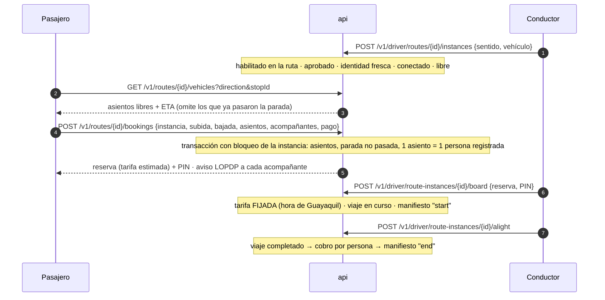

# Módulo 9 — Taxi Ruta

> Estado: **completado** — 2026-10-19. Pruebas: 6 unitarias nuevas de dominio (tarifas, franjas, proyección) + 12 de extremo a extremo (auth + api + sos reales).

## 1. Qué incluye

| Componente | Ubicación |
|---|---|
| Reglas puras: hora local de Guayaquil, franja tarifaria, cobertura 24 h, polilínea, proyección de paradas, ETA | `packages/domain/src/fixed-route.ts` |
| Pasajero y conductor: rutas, vehículos/ETA, cotización, reserva, abordaje con PIN, bajada | `apps/api/src/modules/fixed-routes/fixed-routes.service.ts` |
| Panel (`route_manager`): rutas, paradas, tarifas, horarios, validación con mapas, publicación con cuatro ojos, habilitación de conductores | `fixed-routes/routes-admin.service.ts` |
| Endpoints | `fixed-routes/fixed-routes.controller.ts` |
| Esquema `fixed_routes` | `db/migrations/0013_fixed_routes.sql` |
| **Ruta 1 sembrada en borrador** | `db/migrations/0014_seed_ruta1.sql` |
| Recibo con la tarifa aplicada | `payments.service.ts → receipt()` |
| Simulador: secciones pasajero, conductor y panel | `apps/simulator` |

Todo es configurable desde el panel: agregar la Ruta 2 no requiere cambiar código.

## 2. Tarifa: se fija al confirmar la subida

Decisión aprobada (D14): **la tarifa es la vigente, en hora de `America/Guayaquil`, en el momento en que el conductor confirma el abordaje con el PIN del pasajero.** Quien sube a las 20:59:59 paga $3.00; quien sube a las 21:00:00 paga $4.00.

- Las franjas son intervalos `[inicio, fin)` en hora local y pueden cruzar medianoche (Nocturna 21:00 → 06:30). Ecuador no tiene horario de verano, pero el cálculo usa `Intl` con la zona IANA, así que no depende de la zona del servidor.
- Al reservar y cotizar se muestra la tarifa como **estimada**, con la nota de que se fija al subir.
- Al abordar se guardan en la reserva `fare_rule_id`, `fare_rule_name` y `unit_fare_cents` (congelados); el viaje queda con `final_fare_cents = unitario × asientos`. El recibo muestra la franja aplicada, el unitario, los asientos, las paradas y la hora de subida.
- Las reglas tarifarias **no se borran**: al cambiarlas se retiran (`retired_at`) porque los recibos las citan.
- El panel rechaza tarifas con huecos o solapes (verificación minuto a minuto del horario de servicio; 24 h si la ruta no tiene horario).

## 3. Flujo

Cada reserva es un viaje (`trips.trips` con `type = fixed_route`), por eso reutiliza **sin cambios** el registro de acompañantes (§5.1), los avisos LOPDP, el manifiesto inmutable, el SOS, el seguimiento compartido, la ruta GPS y los pagos. La ubicación del conductor en servicio de ruta alimenta la ruta GPS de cada pasajero que reservó.

Reglas adicionales:
- Las reservas no abordadas expiran a los 45 min y liberan los asientos.
- Mientras hace la ruta, el conductor no recibe viajes bajo demanda.
- No se termina un recorrido con pasajeros a bordo; las reservas pendientes se cancelan al terminar.
- Pausar una ruta impide reservas y recorridos nuevos; los que están en curso terminan normalmente.

## 4. Gestión de rutas y validación con mapas

1. `route_manager` crea la ruta (borrador, con sentidos *ida* y *vuelta*), carga las paradas de cada sentido en orden, las tarifas y los horarios.
2. **Validar** (`POST /v1/admin/routes/{id}/validate`):
   - pide a la API de mapas la ruta directa entre la primera y la última parada y proyecta cada parada sobre ella: si la distancia recorrida no crece con el orden, **avisa** y sugiere un orden. Es **informativo**: el operador conoce el recorrido real (para la Ruta 1 el propietario confirmó que el orden de la especificación es el real);
   - calcula la ruta pasando por las paradas en el orden dado: es la polilínea que se guarda y se muestra al pasajero;
   - avisa de coordenadas sin confirmar en terreno y verifica la cobertura de tarifas.
3. **Publicar** exige ambos sentidos validados y tarifas completas, y la **aprobación de una persona distinta** a la que lo solicitó (lo exige también una restricción `CHECK` en la base de datos).
4. Una ruta activa no se edita: se pausa, se edita y se vuelve a publicar.

### Ruta 1 (sembrada)
- Borrador `R1` *Villa Bonita – Centro*, corredor Vía a Daule → Narcisa de Jesús → Francisco de Orellana → Juan Tanca Marenco → Av. de las Américas.
- Ida: Villa Bonita (origen) · San Marino · Mall del Sol · City Mall · Riocentro Norte · Mall del Río · Parque Centenario · 9 de Octubre · Vélez · Chile y Colón · Bahía – Castillo.
- Vuelta: orden inverso **provisional** (en el Centro hay calles de un solo sentido; el equipo de rutas debe cargar el recorrido real de vuelta).
- Horario: 06:30 a 22:59 (cierra a las 23:00). Tarifas por persona: Diurna 06:30–20:59 $3.00 (furgoneta $2.80), Nocturna 21:00–22:59 $4.00 (furgoneta $3.80). Ver §Horario de servicio.
- **Coordenadas aproximadas y sin verificar** (`location_verified = false`), en especial *Mall del Río*. Antes de publicar: confirmarlas en terreno, validar con la clave de Google Maps y publicar con cuatro ojos.

## 5. Endpoints

| Método y ruta | Quién | Notas |
|---|---|---|
| `GET /v1/routes` · `GET /v1/routes/{id}` | usuario autenticado | solo rutas activas; tarifa vigente y nota de hora |
| `GET /v1/routes/{id}/vehicles?direction&stopId` | usuario | asientos libres, ubicación y ETA |
| `POST /v1/routes/{id}/quotes` | usuario | estimado |
| `POST /v1/routes/{id}/bookings` | app de pasajero + atestación | acompañantes igual que §5.1 |
| `GET /v1/routes/bookings/{id}` · `POST …/cancel` | dueño de la reserva | 404 para cualquier otro |
| `GET /v1/driver/routes` | conductor | rutas habilitadas |
| `POST /v1/driver/routes/{id}/instances` | app de conductor + atestación | |
| `GET /v1/driver/route-instances/current` | conductor | pasajeros reservados y a bordo |
| `POST /v1/driver/route-instances/{id}/board` · `/alight` · `/finish` | conductor dueño de la instancia | PIN con 3 intentos |
| `GET/POST /v1/admin/routes`, `GET /v1/admin/routes/{id}` | `route_manager` | lectura con passkey ≤ 8 h |
| `PUT /v1/admin/routes/{id}/directions/{dir}/stops` · `/fares` · `/schedules` | `route_manager` | escritura con passkey ≤ 15 min; solo en borrador/pausa |
| `POST /v1/admin/routes/{id}/validate` · `/publish-request` · `/publish-decision` · `/pause` | `route_manager` | cuatro ojos |
| `GET/POST /v1/admin/routes/{id}/drivers`, `DELETE …/drivers/{driverId}` | `route_manager` | solo conductores aprobados |

## 6. Riesgos de seguridad y cómo se mitigan

| Riesgo | Mitigación |
|---|---|
| **Sobreventa de asientos** por reservas simultáneas | Transacción con `SELECT … FOR UPDATE` de la instancia + `CHECK (seats_taken BETWEEN 0 AND seats_total)`; probado con reservas en paralelo |
| **Personas no registradas** (reservar 3 asientos y registrar a 1) | 1 asiento = 1 persona registrada: el hook de acompañantes devuelve el tamaño del grupo y debe coincidir (`party_mismatch`) |
| **Manipulación de la tarifa** (reservar de día para pagar barato de noche, o cambiar la hora del teléfono) | La tarifa la calcula el servidor con su reloj y la zona IANA al confirmar el abordaje; el cliente no envía montos ni horas |
| **Cambio malicioso de tarifas o rutas** por un administrador | RBAC `route_manager`, passkey reciente para escribir, cuatro ojos para publicar (también en BD), auditoría inmutable de cada cambio con las franjas; reglas retiradas, no borradas |
| **Abordaje sin el pasajero** (conductor que marca subidas falsas) | PIN del pasajero, 3 intentos y bloqueo; cada intento fallido se audita |
| **IDOR** sobre reservas e instancias | Todas las consultas filtran por `requester_user_id` o `driver_id`; respuesta 404 (no 403) |
| **Conductor no habilitado o no apto** operando la ruta | Habilitación por ruta + elegibilidad (documentos vigentes) + identidad fresca + vehículo propio aprobado + estar conectado |
| **Reserva en un vehículo que ya pasó** | Proyección de la ubicación del conductor sobre la ruta; `stop_passed` |
| **GPS falso** del conductor | Mismas defensas del módulo 4 (saltos imposibles, señal de ubicación simulada) |
| **Reservas fantasma** que bloquean asientos | Límite de 10 reservas/hora por usuario, 1 reserva activa a la vez, expiración a los 45 min |
| **Datos de rutas inyectados** en el panel o la app | Validación estricta (zod), sin `<>` en textos, coordenadas acotadas; las vistas escapan el contenido |
| **Dispositivo comprometido** pagando con tarjeta | Igual que en viajes: solo efectivo si la integridad es básica |

Riesgo residual: las coordenadas sembradas no están verificadas y la ETA usa una velocidad urbana fija (20 km/h); con la clave de Google Maps la polilínea será la real, pero la ETA seguirá siendo aproximada.

## 7. Revisión legal y operativa requerida
- **Regulación de transporte:** Taxi Ruta (cobro por asiento en ruta fija) podría requerir un permiso de operación de transporte comercial o de rutas ante la ANT o la ATM de Guayaquil. **Abogado regulatorio antes de operar.**
- **Información al consumidor:** la tarifa se fija al subir; la app lo avisa al cotizar y reservar, pero conviene validar el texto con un abogado (Ley Orgánica de Defensa del Consumidor).
- **Coordenadas y recorrido de vuelta de la Ruta 1:** confirmación en terreno por el operador de la ruta.

## Horario de servicio (actualización 2026-10-20)

Cada ruta puede tener un horario de servicio `[inicio, fin)` en hora de Guayaquil (`PUT /v1/admin/routes/{id}/service-hours`, `route_manager`, solo en borrador o pausada). Ruta 1: **06:30 a 23:00** — diurna 06:30–20:59, nocturna 21:00–22:59.

Fuera del horario la ruta está **cerrada**:
- La lista y el detalle muestran `open: false`, sin tarifa vigente, y "abre a las 06:30".
- No se cotiza, no se reserva, no se cambia de unidad, no se inicia recorrido y **no se confirma ningún abordaje** (`409 route_closed`). Quien sube a las 22:59:59 paga nocturna; a las 23:00:00 ya no puede subir.
- Quien ya va a bordo termina su viaje con normalidad.
- Las reservas pendientes se liberan automáticamente (barrido cada 30 s) y el pasajero recibe el cambio de estado.

La nocturna anterior (21:00–06:30) se **retiró** (no se borró: los recibos antiguos la siguen citando) y se creó la nueva 21:00–23:00 con el mismo valor (migración `0023_route_service_hours.sql`).

**Riesgos y mitigación:** la hora siempre la decide el servidor (no el teléfono), así que cambiar la hora del celular no permite subir después del cierre; el cierre se aplica también al abordaje, no solo a la reserva, para que nadie quede reservado esperando una unidad que ya no pasará. **Revisión humana:** confirmar con la ATM si el horario 06:30–23:00 de la ruta está autorizado y si hay excepciones en feriados.
