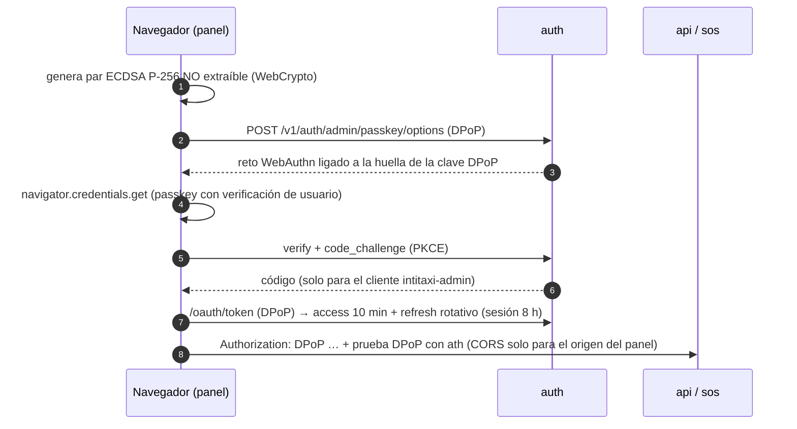

# Módulo 10 — Panel de administración

> Estado: **completado** — 2026-10-19. Pruebas: 5 unitarias del servidor del panel + 9 de extremo a extremo (incluida una en Chromium real con passkey virtual).

## 1. Qué incluye

| Componente | Ubicación |
|---|---|
| Panel web (estático, sin framework, sin dependencias de terceros en el navegador) | `apps/admin-web` |
| Servidor del panel: solo estáticos, CSP estricta, sin sesiones ni proxy | `apps/admin-web/src/server.ts` |
| Sesión del navegador: passkey, PKCE, clave DPoP **no extraíble** en WebCrypto, tokens solo en memoria | `apps/admin-web/public/js/session.js` |
| Backend nuevo: métricas, auditoría, privacidad, KYC duplicados, disputas | `apps/api/src/modules/backoffice` |
| CORS con lista blanca exacta (solo el origen del panel) | `packages/nest-common/src/http.ts` (`CORS_ORIGINS`) |
| Disputas (esquema `support`, relato cifrado) | `db/migrations/0015_disputes.sql` |
| Puente de autenticador **solo de desarrollo** (passkeys del simulador) | `apps/simulator` + `ADMIN_DEV_AUTHENTICATOR_URL` |

Secciones y roles (la API vuelve a comprobar el rol en **cada** petición; el menú solo oculta lo que no corresponde):

| Sección | Rol | Acciones |
|---|---|---|
| Resumen | todos | Cifras agregadas del día (hora de Guayaquil), sin datos personales |
| Conductores | `driver_reviewer` | Cola, documentos (URL de 60 s con motivo), aprobar/rechazar/suspender |
| KYC duplicados | `fraud_analyst` | Rechazar (señal de fraude) o transferir la identidad a la cuenta nueva |
| Fraude y retiros | `fraud_analyst` | Confirmar/descartar señales; pagar/rechazar retiros |
| Disputas | `support` | Ver relato (motivo auditado), asignarse, resolver con reembolso |
| Incidentes SOS | `sos_operator` | Atender, escalar al ECU 911, cerrar; manifiesto con su integridad |
| Taxi Ruta | `route_manager` | Paradas, tarifas, validación, publicación con cuatro ojos, pausa, habilitación |
| Privacidad (LOPDP) | `dpo` | Completar o rechazar solicitudes de titulares; respeta la retención legal |
| Auditoría | `auditor` | Búsqueda en el log inmutable y verificación de la cadena de hash |
| Roles | `super_admin` | Asignar (con expiración) y revocar roles |

## 2. Cómo se autentica el navegador

- **Nada en almacenamiento persistente**: ni `localStorage`, ni `sessionStorage`, ni cookies. Recargar o cerrar la pestaña termina la sesión. Un XSS no podría exportar la clave DPoP (no extraíble) y los tokens robados no sirven sin ella.
- Las **escrituras** exigen passkey verificada hace ≤ 15 min (si caduca, el panel pide volver a entrar).
- CORS sin credenciales: los tokens van en cabeceras, por eso no hay CSRF.

## 3. Backend nuevo

| Método y ruta | Rol | Notas |
|---|---|---|
| `GET /v1/admin/metrics` | todos | Solo conteos/sumas |
| `POST /v1/trips/{id}/disputes` · `GET /v1/disputes` | solicitante o conductor del viaje | Solo viajes terminados, plazo 30 días, 5/día, una abierta por persona y viaje |
| `GET /v1/admin/disputes?status` · `GET …/{id}?reason=` | `support` | El listado no incluye el relato; el detalle exige motivo y se audita con finalidad `dispute_review` |
| `POST /v1/admin/disputes/{id}/assign` · `/resolve` | `support` | Reembolso vía pagos; nadie resuelve un reclamo de un viaje en el que participó; doble resolución imposible |
| `GET /v1/admin/audit?action&resourceType&resourceId&actorUserId&outcome&before&limit` | `auditor` | Paginado por `seq`; filtros validados |
| `POST /v1/admin/audit/verify` | `auditor` | Recalcula toda la cadena; la verificación también se audita |
| `GET /v1/admin/privacy-requests?status` · `POST …/{id}/decision` | `dpo` | "complete" anonimiza; bloqueado si hay retención legal |
| `GET /v1/admin/kyc/reviews` · `POST …/{id}/decision` | `fraud_analyst` | Documento enmascarado; `reject` o `transfer`; sin conflicto de interés |

## 4. Uso local

`pnpm dev` levanta todo. En el simulador (http://localhost:4000) crea un pasajero, inicia sesión y **crea una passkey**; luego crea un dispositivo de administración desde ese pasajero (le asigna el rol). En el panel (http://localhost:4100) elige ese dispositivo en "Desarrollo: usar la passkey de un dispositivo del simulador". Con una passkey real (Touch ID, Windows Hello, llave FIDO2) se usa "Entrar con passkey".

El puente de desarrollo solo existe si se define `ADMIN_DEV_AUTHENTICATOR_URL`; el servidor del panel se niega a arrancar con él en producción, y el simulador solo firma para los orígenes configurados y escucha en `127.0.0.1`.

## 5. Riesgos de seguridad y cómo se mitigan

| Riesgo | Mitigación |
|---|---|
| **Phishing de credenciales de administradores** | Solo passkey (resistente al phishing: ligada al origen); sin contraseñas ni OTP en el panel |
| **Robo de tokens desde el navegador** (XSS, extensiones, malware) | Tokens solo en memoria; DPoP con clave no extraíble; access token de 10 min; CSP `script-src 'self'` sin `unsafe-inline`; todo el contenido de la API se inserta con `textContent` (nunca `innerHTML`) |
| **Escalada de privilegios** | RBAC verificado en la API en cada petición (el menú no es un control); nadie se asigna roles a sí mismo; roles con expiración; escrituras con passkey reciente |
| **Abuso interno / curiosidad** sobre datos personales | Los listados no muestran PII (documentos enmascarados, relatos ocultos); abrir un relato, un documento o un manifiesto exige motivo y deja traza con finalidad; métricas solo agregadas |
| **Conflicto de interés** | No se resuelven reclamos de viajes propios ni revisiones KYC propias; publicación de rutas y entrega a autoridades con cuatro ojos |
| **Manipulación del log de auditoría** | Tabla solo inserción con hash encadenado; el auditor verifica la cadena desde el panel; réplica en S3 con Object Lock (infraestructura) |
| **CORS mal configurado** | Lista blanca exacta, sin comodines ni credenciales; en producción solo `https://`; el resto de orígenes no recibe cabeceras CORS |
| **Clickjacking / fuga por Referer** | `frame-ancestors 'none'`, `Referrer-Policy: no-referrer`, `COOP same-origin` |
| **Path traversal** en el servidor del panel | Resolución contra el directorio raíz y lista blanca de tipos; probado con rutas codificadas |
| **Doble reembolso** por dos agentes | La disputa se reclama de forma atómica antes del reembolso; el pago además tiene su propio control de doble gasto |
| **Exposición del panel a internet** | Debe publicarse solo detrás de **ZTNA** (p. ej. Cloudflare Access / AWS Verified Access) con dispositivos gestionados; ver revisión |
| **Puente de desarrollo filtrado a producción** | Prohibido por configuración (el servidor no arranca) y por el simulador (no arranca con `NODE_ENV=production`) |

Riesgos residuales: el panel no tiene todavía bloqueo de pantalla por inactividad ni "step-up" automático (si la passkey tiene más de 15 min, las escrituras responden 401/403 y hay que volver a entrar); la vista de incidentes no se actualiza en vivo (se puede suscribir al canal `ops:incidents` del servicio realtime en una siguiente iteración).

## 6. Revisión humana requerida
- **Configuración ZTNA** y política de dispositivos gestionados para el personal (equipo de seguridad).
- **Matriz de roles y segregación de funciones** (quién puede tener qué combinación de roles): dirección + seguridad.
- **Procedimiento de transferencia de identidad KYC** (cómo se confirma que es la misma persona): legal + DPO.
- **Plazos y textos de respuesta a titulares** (LOPDP): DPO + abogado.
- **Pentest del panel** antes del lanzamiento.
